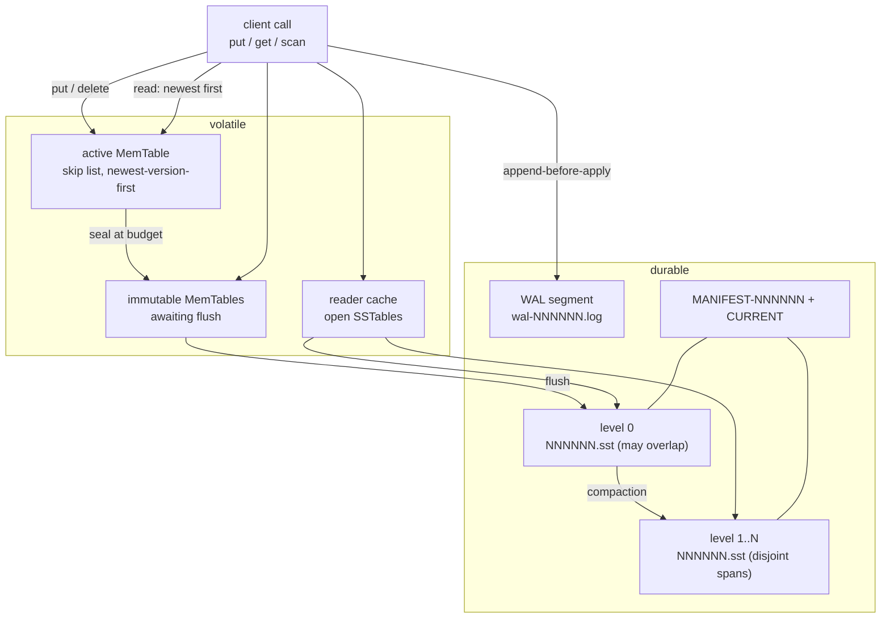
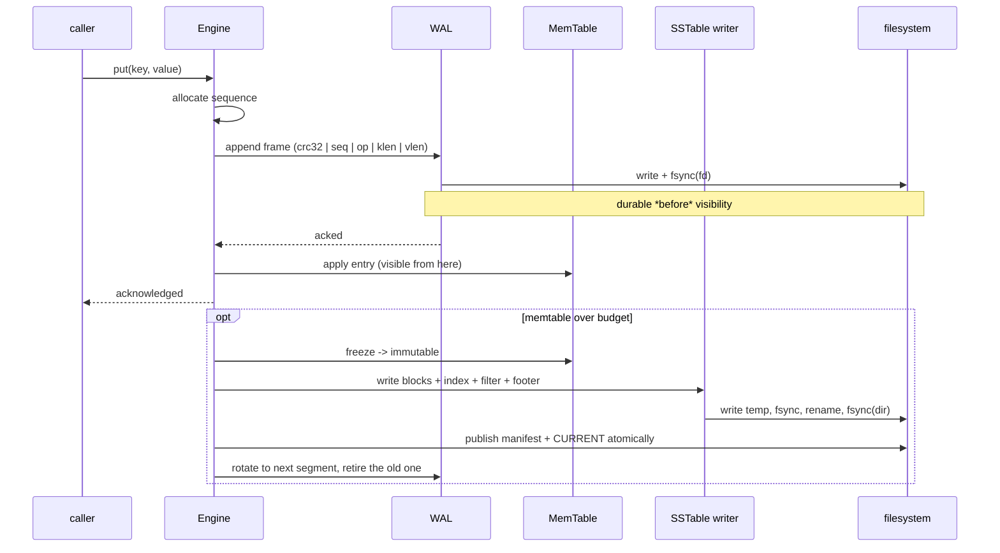
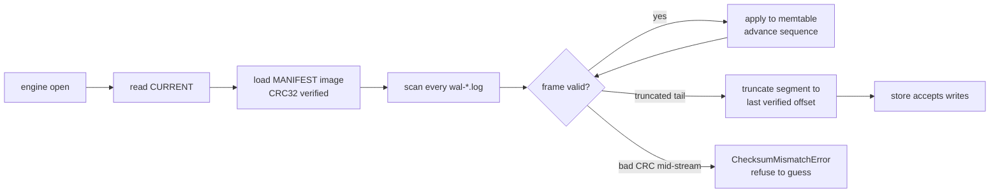

# sable

A crash-safe, pure-Python LSM-tree key-value storage engine reference
implementation with WAL, binary SSTables, Bloom filters, and snapshot-safe
compaction.

[](https://github.com/MKA930/sable/actions/workflows/ci.yml)
[](https://www.python.org/)
[](LICENSE)
[](pyproject.toml)

`sable` is a complete single-node storage engine in roughly 1,600 lines of pure
Python: a chronological write-ahead log, a skip-list memtable, leveled immutable
SSTables with per-block checksums and Bloom filters, a multi-level merge read
path, and a compactor that reclaims versions nobody can read any more.

```console
$ sable put hello world
ok
$ sable get hello
world
$ sable stats --json | head -20
```

## Table of contents

- [Design Philosophy & Non-Goals](#design-philosophy--non-goals)
- [Architecture](#architecture)
- [Write path](#write-path)
- [Durability envelope](#durability-envelope)
- [Crash recovery](#crash-recovery)
- [Snapshots and concurrency](#snapshots-and-concurrency)
- [Quickstart](#quickstart)
- [File layout](#file-layout)
- [Testing](#testing)
- [Benchmarks](#benchmarks)
- [License](#license)

## Design Philosophy & Non-Goals

`sable` is designed as a **clean-room, audit-friendly reference implementation** of an LSM-tree storage engine. Its primary objective is not to compete with industrial C++/Rust engines (like RocksDB or Pebble) on raw IOPS, but to provide a rigorously verifiable, self-contained demonstration of crash-consistency and concurrent snapshot mechanics.

### Goals
- **Deterministic Crash-Consistency**: Strict adherence to OS filesystem invariants (`append-before-apply`, `write-temp → fsync → rename → fsync(parent-dir)`).
- **Verifiable Correctness**: A comprehensive test suite featuring SIGKILL crash injection and multi-threaded race barriers.
- **Auditable Clarity**: Under 2,000 lines of pure Python logic, making every byte-level layout and state transition inspectable without sprawling abstraction layers.

### Non-Goals
- **Sub-millisecond Raw Throughput**: We do not bypass the Python runtime or CPython GIL to chase microsecond read/write benchmarks.
- **Distributed Coordination**: `sable` focuses exclusively on single-node persistent storage semantics.

## Architecture



Reads descend freshest-first and stop at the **first version found**, tombstone or
not. That is deliberate: a tombstone is what masks elder versions sitting in lower
levels, so encountering one is the hiding mechanism rather than an error.

| Subsystem | Module | Responsibility |
| --- | --- | --- |
| Types & options | `sable.types` | `InternalEntry`, `KeyRange`, `SSTableMeta`, budgets |
| Error taxonomy | `sable.errors` | corruption vs. torn write vs. caller mistake |
| Durability | `sable.fsutil` | `temp → fsync → rename → fsync(parent-dir)` |
| WAL | `sable.wal` | frame layout, CRC32, torn-tail truncation |
| MemTable | `sable.memtable` | deterministic skip list, `(key, -sequence)` order |
| SSTable | `sable.sstable` | blocks, index, Bloom filter, footer |
| Bloom filter | `sable.bloom` | probabilistic pruning before any block IO |
| Compaction | `sable.compaction` | leveled planner, tombstone reclamation |
| Engine | `sable.engine` | version set, manifest, reads, snapshot leases |
| CLI | `sable.cli` | `put`, `get`, `delete`, `scan`, `stats` |

## Write path

`put` is acknowledged only after its frame is durable. Nothing about that relies
on timing, buffering luck, or how the interpreter shuts down.



## Durability envelope

| Operation | Guarantee |
| --- | --- |
| `put` / `delete` | acknowledged ⇒ frame survived an fsync, therefore survives process death |
| `flush` | the SSTable either exists complete or is absent; never partial |
| manifest publish | new image written to a sibling temp file, fsync-ed, renamed, then `CURRENT` swapped |
| directory fsync | performed after every rename/unlink so directory entries are durable too |
| Windows | directory fsync is unsupported by the platform; it is skipped deliberately rather than faked |

## Crash recovery

Recovery has no replay semantics to argue about: `CURRENT` names one complete
manifest image, and the WAL is scanned frame by frame until a checksum or length
disagrees.



The distinction that matters is between a **torn tail** (partial write at the end
— expected, discardable) and a **bad checksum mid-stream** (real corruption —
refuses to proceed). Treating both the same way is how recovery either silently
drops acknowledged writes or silently accepts damaged ones.

## Snapshots and concurrency

```python
with engine.snapshot() as view:
    engine.put(b"key", b"newer")   # invisible to `view`
    assert view.get(b"key") == b"older"
```

Three mechanisms, three problems — conflating them is what makes this layer
usually wrong:

| Mechanism | Protects | Why nothing else works |
| --- | --- | --- |
| File leases (`SSTableMeta.refs`) | bytes still being read | a compaction may drop visibility immediately, but must not unlink under a live reader |
| Version retention (`visible_versions`) | versions a view still resolves | pinning cannot help: the replacement file simply lacks the version |
| Structural lock (`MemTable`) | the shape being traversed | readers materialise their run, so writers are never blocked for a whole scan |

A view holds nothing but an integer, yet every version inside its visibility band
`[sequence, newer.sequence)` survives the merge, and a tombstone is never dropped
while an older view could still be reading the value underneath it.

## Quickstart

```bash
pip install -e .            # or: python -m pip install /path/to/sable
sable --help
```

```python
from sable import Engine, EngineOptions

engine = Engine.open("./sable-data", EngineOptions(memtable_bytes_threshold=1 << 20))
engine.put(b"alpha", b"one")
engine.put(b"beta", b"two")
engine.delete(b"alpha")

assert engine.get(b"alpha") is None
assert list(engine.scan()) == [(b"beta", b"two")]

engine.flush()
while engine.compact():
    pass
engine.close()
```

Docker, with state on a named volume so it survives the container:

```bash
docker build -t sable .
docker run --rm -v sable-data:/data sable put hello world
docker run --rm -v sable-data:/data sable get hello   # -> world
```

Each `docker run` is otherwise ephemeral by design: the image keeps no state of
its own, the volume does.

## File layout

```
sable-data/
├── CURRENT                 points at the visible manifest
├── MANIFEST-00000N         complete version image (CRC32 protected)
├── wal-000001.log          append-only frames, fsync-ed per write
├── 000001.sst              level 0 (newest flushed memtable)
└── 000002.sst              level 1..N after compaction
```

An SSTable is laid out so every region is either verified or skippable:

```
HEADER (100 B) | DATA BLOCKS (crc32 each) | INDEX BLOCK | FILTER BLOCK | FOOTER (16 B)
```

## Testing

```bash
pytest -q                                   # everything
pytest -q --cov=sable --cov-fail-under=85 tests/
pytest tests/test_crash.py -v               # 10 SIGKILL injection points
pytest tests/test_concurrent.py -v          # barrier-driven compactor / scanner races
python examples/crash_demo.py               # prints "recovered: N", non-zero on failure
```

Every concurrency test rendezvouses on a `threading.Barrier` rather than sleeping,
so the intended overlap is guaranteed rather than merely likely. Hung workers fail
the run instead of hanging CI.

## Benchmarks

Measured with `python -m benchmarks.bench_engine --markdown` — one run, on this
machine, with `fsync` enabled for every acknowledged write:

- Engine: sable 0.1.0
- Python: 3.11.1 (linux-x86_64)
- OS: Linux 6.6.117-45.11.3.tl4.x86_64
- CPU count: 32
- Value size: 64 bytes, 5,000 keys, seed 20261030

| workload | iterations | seconds | ops/sec | MiB/s |
|---|---|---|---|---|
| put (durable, fsync each) | 5,000 | 22.419 | 223 | 0.01 |
| flush -> L0 | 5,000 | 0.061 | 82,365 | 0.00 |
| get hit | 5,000 | 0.235 | 21,298 | 0.00 |
| get miss | 5,000 | 0.041 | 122,219 | 0.00 |
| full scan | 20 | 0.208 | 96 | 0.00 |
| compaction (jobs) | 1 | 0.118 | 9 | 0.00 |
| reopen + replay | 10 | 0.009 | 1,076 | 0.00 |
| put (fsync disabled) | 5,000 | 0.046 | 108,687 | 6.63 |

```
get miss / get hit      : 5.74x (Bloom pruning vs. a block read)
fsync disabled / durable: 487.33x (the price of surviving a crash)
```

Reading these honestly:

- **Durable writes cost what stable storage costs.** 223 ops/sec is around 4.5 ms
  per `fsync` on this filesystem, and the same workload without it is 487x faster.
  The engine is not the bottleneck; the disk is. That is the correct shape for a
  store whose acknowledgement means "survives process death".
- **Absent keys are 5.7x cheaper than present ones** because the Bloom filter
  rejects them without reading a data block. This is the single clearest
  observable effect of the filter block.
- **Scan throughput is per full range walk**, not per key: 96 walks/sec over
  5,000-key ranges is roughly 480k keys/sec through the multi-level merge.
- **Reopen cost is dominated by WAL replay**, and stays in the single-digit
  millisecond range at this scale.

Reproduce with different shapes:

```bash
python -m benchmarks.bench_engine --iters 20000 --value-bytes 256 --markdown
```

Numbers from one run on one machine; treat the ratios as the result and the
absolute figures as a snapshot.

## License

MIT — see [LICENSE](LICENSE).

---

[中文文档](README.zh-CN.md)
