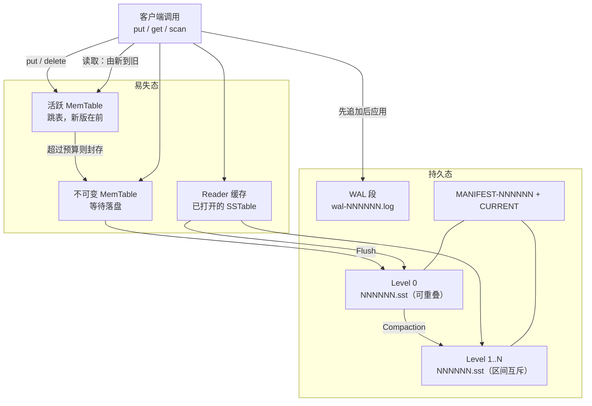
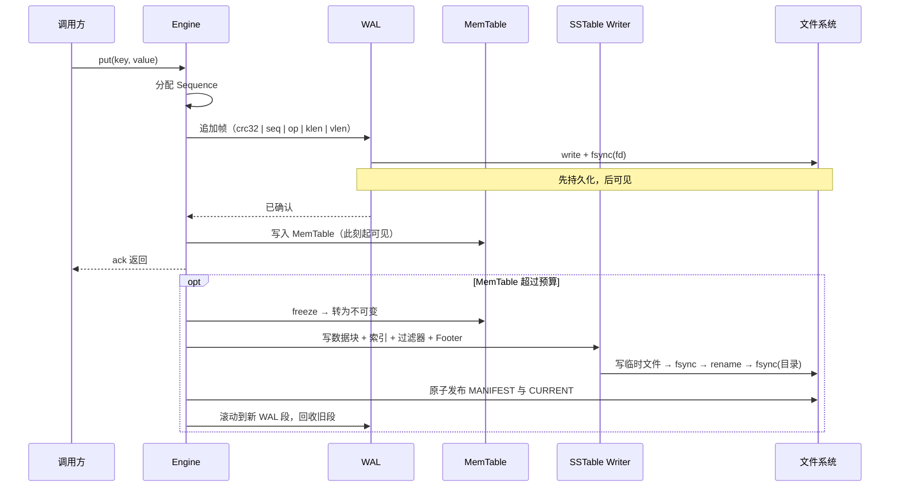
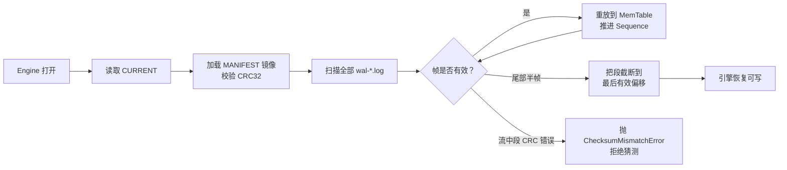
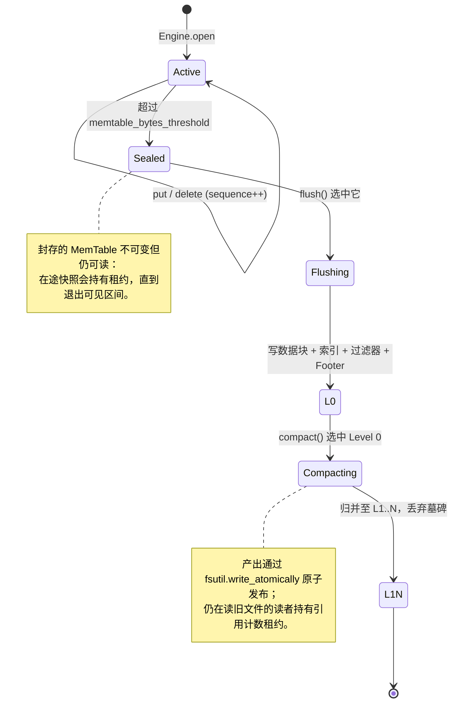
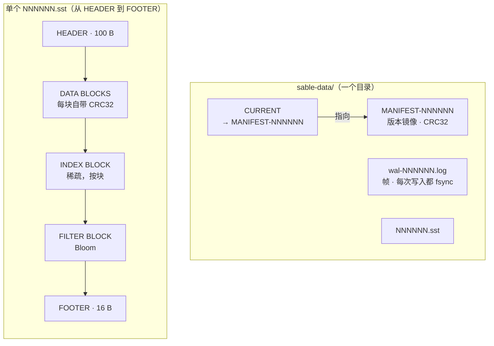

[English](README.md) | [简体中文](README.zh-CN.md)

# sable

一个崩溃安全（Crash-Safe）的纯 Python LSM-Tree 键值存储引擎参考实现，内置 WAL、
二进制 SSTable、Bloom Filter 与快照安全的 Compaction。

[](https://github.com/MKA930/sable/actions/workflows/ci.yml)
[](https://www.python.org/)
[](LICENSE)
[](pyproject.toml)
[](docs/README.zh-CN.md)

`sable` 用 **1,826 行纯 Python 逻辑**（含解释每种布局的 docstring 共 3,416 行）
实现了一个完整的单机存储引擎：顺序写的预写日志、跳表 MemTable、带块级校验和与
Bloom Filter 的分层不可变 SSTable、跨层归并读路径，以及一个回收“无人可读版本”的
Compactor。

```console
$ sable put hello world
ok
$ sable get hello
world
$ sable stats --json | head -20
```

## 目录

- [文档](#文档)
- [设计哲学与边界](#设计哲学与边界-design-philosophy--non-goals)
- [整体架构](#整体架构)
- [写路径](#写路径)
- [持久化边界](#持久化边界)
- [崩溃恢复](#崩溃恢复)
- [MemTable 与刷盘状态机](#memtable-与刷盘状态机)
- [快照与并发](#快照与并发)
- [文件布局](#文件布局)
- [快速开始](#快速开始)
- [测试矩阵](#测试矩阵)
- [基准测试](#基准测试)
- [许可证](#许可证)

## 文档

[`docs/`](docs/README.zh-CN.md) 下的工程知识库，是本主文档的长文配套：深入的工程
实践指南、双语硬核问答、架构决策记录（ADR）、基准测试脚本、实测性能报告，以及基于引擎的
实践配方。当你需要的是「**为什么**」而非「**怎么做**」时，从这里开始。

| 知识库入口 | 内容 |
| --- | --- |
| [工程实践 Skills](docs/README.zh-CN.md#工程实践-skills底层实现指南) | WAL/截断恢复、原子落盘、并发控制——每篇都锚定源码 |
| [硬核问答 FAQ（中文）](docs/faq/interview-qa-zh.md) | 八个存储系统追问，配 Mermaid 图解 |
| [ADR-001 … ADR-005](docs/README.zh-CN.md#架构决策记录-adr) | 每个磁盘/内存契约背后的决策 |
| [基准测试](docs/README.zh-CN.md#基准测试-benchmarks) | 并发压测、WAL 吞吐上限、读放大矩阵 |
| [实测报告](docs/reports/benchmark-2024.md) | 这个引擎在一台具名机器上到底跑到多少，以及这些数字**不**覆盖什么 |
| [实践配方](docs/README.zh-CN.md#实践配方-recipes) | 用引擎搭东西，例如只用范围扫描与墓碑做 [TTL 淘汰](docs/recipes/ttl-eviction.md) |

上述保证背后的断言，由 [`tests/test_crash.py`](tests/test_crash.py)（十个 SIGKILL
注入点）与 [`tests/test_concurrent.py`](tests/test_concurrent.py)（Barrier 驱动的
Compaction / Scan 竞态）共同验证；[`examples/crash_demo.py`](examples/crash_demo.py)
则端到端演示崩溃恢复。

## 设计哲学与边界 (Design Philosophy & Non-Goals)

`sable` 的定位是一个**严格注重崩溃安全与代码审计透明度的 LSM-Tree 参考实现（Reference Implementation）**。它的目标从来不是在极限 IOPS 上与 RocksDB、Pebble 这类数万行 C++/Rust 工业引擎竞争，而是以极简、清晰的架构，完整还原存储引擎底层最核心的并发与崩溃一致性不变量。

### 我们关注的 (Goals)
- **确定的崩溃一致性**：严格遵守 POSIX 文件系统的刷盘顺序约束（写入临时文件 → `fsync` → 原子替换 → `fsync` 父目录）。
- **可证伪的正确性验证**：包含由 SIGKILL 注入驱动的崩溃测试矩阵与多线程 Barrier 竞态测试。
- **高可读与教学级解构**：在 2000 行纯 Python 代码内呈现清晰的二进制帧布局与 Compaction 状态机，无任何冗余的抽象噪音。

### 我们不追求的 (Non-Goals)
- **极限并发吞吐**：受限于 CPython 解释器与 GIL，本项目旨在保证绝对的数据正确性，而非追求微秒级的吞吐表现。
- **分布式协同**：专注于单机持久化存储语义，不引入网络与集群状态。

## 整体架构



读路径由新向旧逐级下探，并在**遇到的第一个版本**处停下——即使那是一个墓碑（Tombstone）。
这是刻意为之：墓碑正是用来遮蔽下层旧版本的手段，遇到它说明遮蔽生效，而不是读失败。

| 子系统 | 模块 | 职责 |
| --- | --- | --- |
| 类型与配置 | [`sable.types`](src/sable/types.py) | `InternalEntry`、`KeyRange`、`SSTableMeta`、容量阈值 |
| 错误契约 | [`sable.errors`](src/sable/errors.py) | 区分损坏、半帧写入与调用方误用 |
| 持久化原语 | [`sable.fsutil`](src/sable/fsutil.py) | `临时文件 → fsync → rename → fsync(父目录)` |
| WAL | [`sable.wal`](src/sable/wal.py) | 帧布局、CRC32、半帧尾部截断 |
| MemTable | [`sable.memtable`](src/sable/memtable.py) | 确定性跳表，按 `(key, -sequence)` 排序 |
| SSTable | [`sable.sstable`](src/sable/sstable.py) | 数据块、索引块、过滤器块、Footer |
| Bloom Filter | [`sable.bloom`](src/sable/bloom.py) | 在任何块 IO 之前做概率剪枝 |
| Compaction | [`sable.compaction`](src/sable/compaction.py) | 分层调度器与墓碑物理回收 |
| Engine | [`sable.engine`](src/sable/engine.py) | 版本集、MANIFEST、读路径、快照租约 |
| CLI | [`sable.cli`](src/sable/cli.py) | `put`、`get`、`delete`、`scan`、`stats` |

## 写路径

只有当写入帧**真正落盘**之后，`put` 才会返回。这一点不依赖任何时序运气、缓冲行为或解释器退出方式。



## 持久化边界

| 操作 | 保证 |
| --- | --- |
| `put` / `delete` | 一旦 ack，说明该帧已通过 fsync，进程被杀也不会丢 |
| `flush` | SSTable 要么完整存在、要么不存在，不存在“半个文件” |
| MANIFEST 发布 | 先写同级临时文件并刷盘，再 rename，最后替换 `CURRENT` |
| 目录 fsync | 每次 rename / unlink 后都执行，保证目录项本身持久化 |
| Windows | 平台不支持对目录 fd 做 fsync，此处显式跳过而非假装成功 |

## 崩溃恢复

恢复过程不需要任何“重放语义”的争论：`CURRENT` 指向一份完整的 MANIFEST 镜像，而 WAL 按帧逐个扫描，直到校验和或长度不再自洽。



真正关键的区分是：**尾部半帧**（末尾的不完整写入，属于预期情况，可以丢弃）与**流中段校验失败**（真实损坏，必须拒绝继续）。把二者混为一谈，恢复逻辑要么静默丢掉已确认的写入，要么静默接受已经损坏的数据。

## MemTable 与刷盘状态机

上文的持久化与并发保证，建立在一台小而明确的状态机之上。跳表位于
[`sable.memtable`](src/sable/memtable.py)，状态迁移由
[`sable.engine`](src/sable/engine.py) 中的 `Engine` 驱动。



封存的 MemTable 绝不是“冻死”的：在途快照会持续从它解析版本，直到自身关闭；之后消费它的
Compaction 也不能在租约仍持有时 `unlink` 该文件。租约规则与证明其正确的 Barrier 竞态测试，见
[并发控制指南](docs/skills/concurrency-control.md)。

## 快照与并发

```python
with engine.snapshot() as view:
    engine.put(b"key", b"newer")   # 对 view 不可见
    assert view.get(b"key") == b"older"
```

三套机制解决三个问题——把它们混为一谈，正是这一层最常见的错误来源：

| 机制 | 保护对象 | 为什么别的办法都不行 |
| --- | --- | --- |
| 文件租约（`SSTableMeta.refs`） | 正在读取的字节 | Compaction 可以立刻取消文件的可见性，但只要还有读者就不能 unlink |
| 版本保留（`visible_versions`） | 视图仍会解析到的版本 | 文件留着也没用：合并后的新文件里根本没有那个版本 |
| 结构锁（`MemTable`） | 正在遍历的链表结构 | 读者先固化要遍历的区间，写者不会为一次扫描而整体阻塞 |

一个视图只持有一个整数，但其可见区间 `[sequence, newer.sequence)` 内的所有版本都会在合并中被保留；同时只要有更老的视图还在读某个值，其上的墓碑就绝不会被删除。

## 文件布局

存储目录即一个目录；其中每件产物要么经 CRC32 校验、要么可被跳过；单个 SSTable 也按
“每段独立可校验”的方式排布。



落盘后的目录树：

```
sable-data/
├── CURRENT                 指向当前可见的 MANIFEST
├── MANIFEST-00000N         完整版本镜像（带 CRC32 保护）
├── wal-000001.log          仅追加写入的帧，每次写入都 fsync
├── 000001.sst              Level 0（最新一次 Flush 的产物）
└── 000002.sst              Compaction 之后落到 Level 1..N 的文件
```

单个 SSTable 的布局保证每一段数据都“要么被校验、要么可被跳过”：

```
HEADER (100 B) | DATA BLOCKS（每块自带 crc32）| INDEX BLOCK | FILTER BLOCK | FOOTER (16 B)
```

## 快速开始

```bash
pip install -e .            # 或：python -m pip install /path/to/sable
sable --help
```

```python
from sable import Engine, EngineOptions

engine = Engine.open("./sable-data", EngineOptions(memtable_bytes_threshold=1 << 20))
engine.put(b"alpha", b"one")
engine.put(b"beta", b"two")
engine.delete(b"alpha")

assert engine.get(b"alpha") is None
assert list(engine.scan()) == [(b"beta", b"two")]

engine.flush()
while engine.compact():
    pass
engine.close()
```

Docker 用法（状态放在具名卷里，容器销毁后依然存在）：

```bash
docker build -t sable .
docker run --rm -v sable-data:/data sable put hello world
docker run --rm -v sable-data:/data sable get hello   # -> world
```

除此之外每一次 `docker run` 都是无状态的：镜像自身不保存任何数据，数据只在卷里。

## 测试矩阵

```bash
pytest -q                                   # 全量
pytest -q --cov=sable --cov-fail-under=85 tests/
pytest tests/test_crash.py -v               # 10 个 SIGKILL 注入点
pytest tests/test_concurrent.py -v          # Barrier 驱动的 Compaction / Scan 竞态
python examples/crash_demo.py               # 输出 "recovered: N"，失败时退出码非 0
```

所有并发测试都用 `threading.Barrier` 会合，而不是靠 `sleep` 等待，因此“被测交叠”是被保证发生的，而不是碰巧发生；工作线程一旦卡死，测试会直接失败而不是把 CI 挂住。

## 基准测试

由 `python -m benchmarks.bench_engine --markdown` 实测得到——单次运行、本机环境、
每一条已确认写入都执行 `fsync`：

- Engine: sable 0.1.0
- Python: 3.11.1 (linux-x86_64)
- OS: Linux 6.6.117-45.11.3.tl4.x86_64
- CPU count: 32
- 值大小：64 字节，5,000 个键，随机种子 20261030

| workload | iterations | seconds | ops/sec | MiB/s |
|---|---|---|---|---|
| put (durable, fsync each) | 5,000 | 22.419 | 223 | 0.01 |
| flush -> L0 | 5,000 | 0.061 | 82,365 | 0.00 |
| get hit | 5,000 | 0.235 | 21,298 | 0.00 |
| get miss | 5,000 | 0.041 | 122,219 | 0.00 |
| full scan | 20 | 0.208 | 96 | 0.00 |
| compaction (jobs) | 1 | 0.118 | 9 | 0.00 |
| reopen + replay | 10 | 0.009 | 1,076 | 0.00 |
| put (fsync disabled) | 5,000 | 0.046 | 108,687 | 6.63 |

```
get miss / get hit      : 5.74x（Bloom 剪枝 vs. 读取一个数据块）
fsync disabled / durable: 487.33x（为“进程被杀也不丢”付出的代价）
```

如何解读这些数据：

- **持久化写入的成本就是稳定存储的成本。** 223 ops/sec 折合约 4.5 ms 一次 `fsync`；
  同一个负载关掉 fsync 后快 487 倍。瓶颈不在引擎而在磁盘——对于“ack 即代表能活过
  进程崩溃”的存储引擎，这正是应有的形态。
- **不存在的键比存在的键快 5.7 倍**，因为 Bloom Filter 直接拒绝，不需要读取任何
  数据块。这是过滤器块带来的最直观收益。
- **扫描吞吐以“整段范围遍历”为单位**：96 次/秒 × 5,000 键 ≈ 48 万键/秒，走的
  是跨层归并路径。
- **重开成本主要来自 WAL 重放**，在这个数据量级下仍是个位数毫秒。

换一组参数复测：

```bash
python -m benchmarks.bench_engine --iters 20000 --value-bytes 256 --markdown
```

压测变体一并提供——见 [`benchmarks/bench_concurrent.py`](benchmarks/bench_concurrent.py)
（并发读 vs. 实时 Compaction）与 [`benchmarks/bench_wal_throughput.py`](benchmarks/bench_wal_throughput.py)
（持久 / 分组 / 非安全写入的吞吐上限）。

以上均为单次运行的本机数据：比值是结论，绝对值只是一个快照。

## 许可证

MIT —— 详见 [LICENSE](LICENSE)。

---

[English README](README.md)
