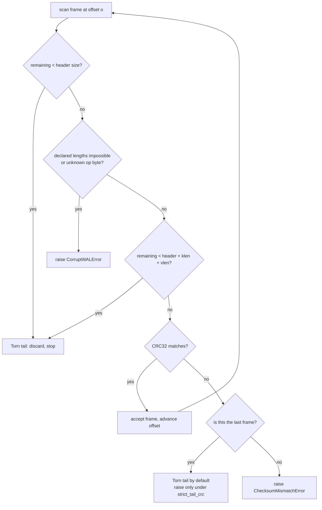
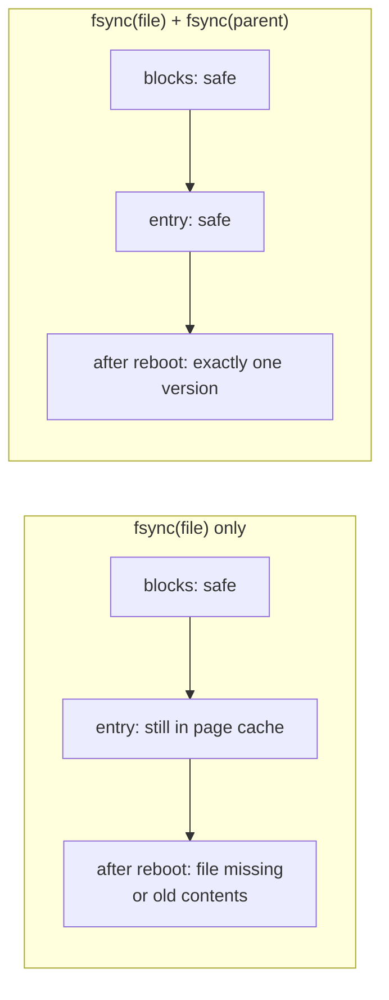
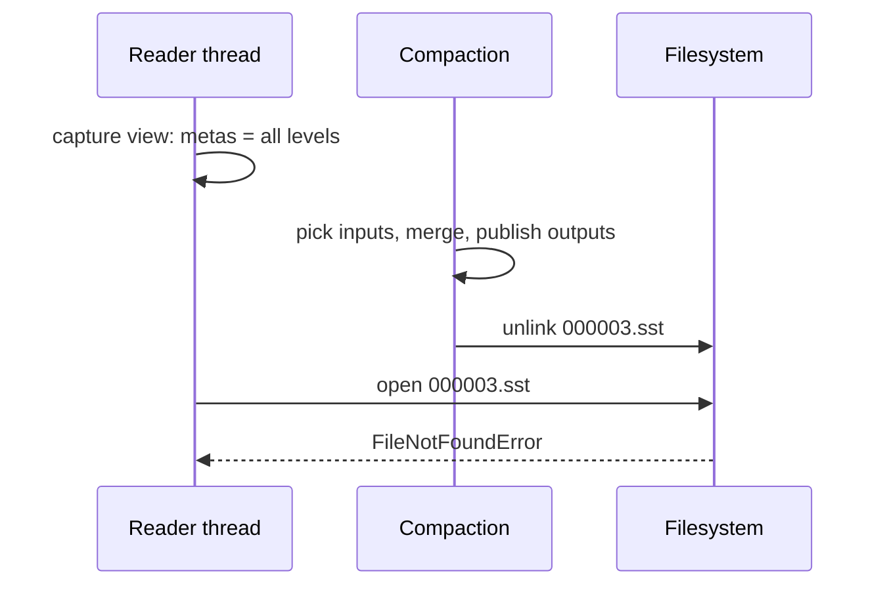
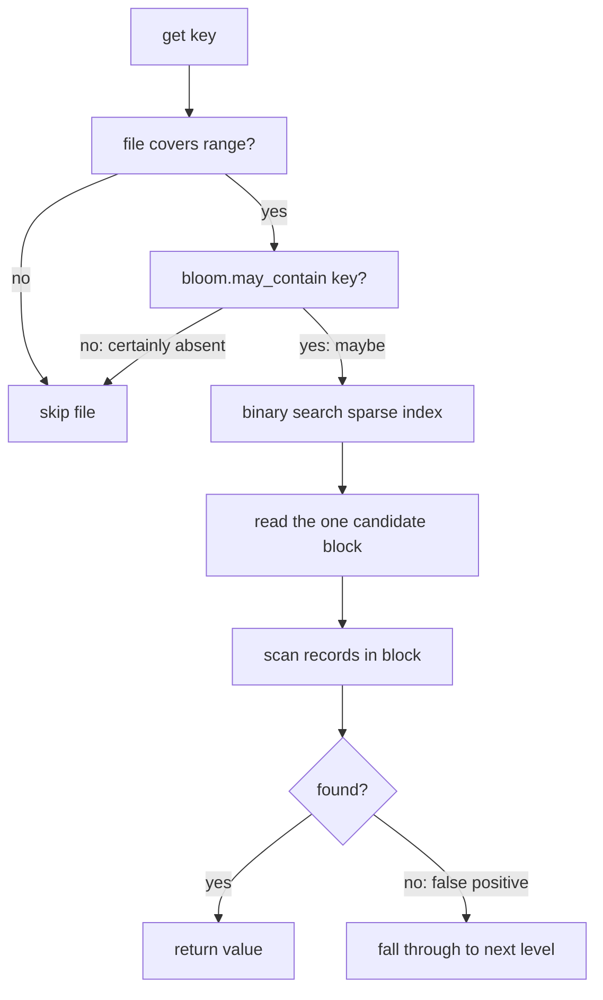

# Storage Engine Deep-Dive Q&A

Nine questions about write-ahead logging, atomic publish, concurrency, tombstones
and Bloom filters. Every answer is anchored to code in this repository — file and
symbol names are given so the claim can be checked rather than taken on faith.

Companion documents: [`../skills/wal-and-recovery.md`](../skills/wal-and-recovery.md),
[`../skills/atomic-flush.md`](../skills/atomic-flush.md),
[`../skills/concurrency-control.md`](../skills/concurrency-control.md).
中文版本见 [`interview-qa-zh.md`](interview-qa-zh.md)。

---

## 1. Write-ahead log and recovery

### Q1. Why does the WAL use a CRC32 + length-prefixed frame structure? Couldn't you just store JSON lines?

You could, and it would work right up to the moment a crash happened. The frame
exists to make one specific question *decidable*: **is this trailing garbage an
incomplete write, or is it data that was corrupted after it landed?**

The frame is `struct.Struct("<IQBII")` — crc32, sequence, op, klen, vlen — a
21-byte fixed header followed by `klen + vlen` payload bytes
(`encode_frame` in `src/sable/wal.py`). Two design consequences follow directly:

**The stream is self-describing.** From any byte offset you can compute where the
next frame starts without consulting an external index. The scanner is a
`while offset < total` loop. There is no resync step, because there is nothing to
resync to — the length prefix is authoritative.

**"Complete" is an integer comparison.** With `klen` and `vlen` in hand, the
scanner knows before reading the payload whether the frame fits in the remaining
bytes:

```python
frame_bytes = FRAME_HEADER_SIZE + klen + vlen
if remaining < frame_bytes:
    result.discarded_bytes += remaining
    result.torn_tail = True
    break
```

Newline-delimited JSON cannot answer that question. `{"k": "a` is ten bytes of
syntactically incomplete JSON, and a parse failure is indistinguishable from a
value that happens to be malformed. To decide torn-vs-corrupt you would have to
parse, and parsing is exactly what a partial write defeats. You would end up
reintroducing an explicit length field anyway — at which point you have JSON
wrapped in a length-prefixed envelope, paying for both.

Two further reasons, less fundamental but not nothing:

- **Byte safety.** Keys and values here are arbitrary bytes. A text format
  requires the payload never to contain the delimiter, so every write pays an
  escape or base64 encode and every read pays the decode — inside the hottest
  loop in the engine, to work around a defect in the framing choice.
- **Cost.** `struct.pack` writes into one buffer. A general-purpose encoder
  allocates intermediate dicts and strings per record.

The CRC32 sits *first* and covers everything after itself, so a streaming reader
computes the digest in one forward pass with no seek-back, and can reject a frame
before allocating its key and value slices.

The honest framing: this is not "binary is faster than JSON". It is that a
self-describing fixed header is what makes recovery *provable*, and JSON does not
give you one at any price. See [`../skills/wal-and-recovery.md`](../skills/wal-and-recovery.md) §2.

### Q2. When a torn tail happens, why discard it instead of trying to repair?

Because there is nothing to repair, and attempting the repair would violate the
contract.

The engine follows **append-before-apply**: `Engine._stage_mutation` allocates a
sequence, appends and fsyncs the WAL frame, and only then inserts into the
memtable. A frame that did not reach stable storage was never acknowledged to any
caller. Discarding it is not losing promised data — it is declining to invent
unpromised data.

"Repairing" would mean one of:

- **Zero-fill the gap.** You now hold a frame whose payload is zeros. Is that a
  legitimate zero-length value, or a hole where real bytes used to be? The
  recovery result cannot say, and the memtable would accept either.
- **Reconstruct from the memtable.** The memtable is gone; the process died.
- **Guess the length.** The length fields are the only thing that might have
  survived, and if the payload did not follow them, the frame is incomplete by
  definition.

The `fsync` boundary is the only line the engine can honestly draw. It is also
the only one a caller can reason about: `put()` returning means "this survived
process death", and nothing weaker.

There *is* a case where the engine refuses to discard, and the distinction is
the interesting part:



A CRC failure in a frame that has *more frames after it* cannot be explained by a
crash. The log is append-only and the filesystem does not reorder a completed
`fsync`, so valid bytes after broken bytes mean the bytes were mutated after they
landed — bit rot, a bad block, a truncated-then-appended copy. That is promised
data that has been lost, and the only honest response is to refuse to guess.

A CRC failure in the *terminal* frame is genuinely ambiguous: a partial write
whose length fields landed is byte-for-byte identical to a complete frame with a
flipped bit. No test separates them. So the default answers the operationally
useful question — "is this file safe to replay?" — with yes, and
`strict_tail_crc=True` opts into failing loudly for audit use.

Repair itself is idempotent by construction: `valid_bytes` is a pure function of
the byte image, so scanning twice gives the same offset and
`truncate_torn_tail` is a no-op when already satisfied
(`if valid_bytes >= size: return 0`). Recovery is safe to run any number of
times, which is the only way to be confident it is safe to run once.

---

## 2. Atomic publish

### Q3. `os.replace()` is already atomic. Why fsync the parent directory on top of it? What actually happens after a power loss if you skip it?

`os.replace` is atomic with respect to *concurrent readers*: they observe either
the old file or the new one, never a blend. That solves a different problem than
the one `fsync(parent)` solves.

`replace` is a **directory-entry mutation**, and a directory entry is itself data
that must reach stable storage. `fsync(file)` covers the file's blocks. Nothing
so far has covered the mapping from `000004.sst` to an inode.

Skip it and you get the classic failure that process-kill tests can never show:

> The data is perfectly durable. The name is not.

On reboot the directory entry may still point at the **old** inode — so your new
SSTable has silently vanished and the manifest now describes a file whose
contents are stale — or the entry may be missing entirely, even though the blocks
are sitting on disk with a valid footer. In `sable` the manifest goes through the
same publish path, so a lost directory entry means either a manifest referencing
files that do not exist, or files that exist but are unreferenced. Recovery has
no way to tell which happened, because both look like "a file is missing".

The same argument applies to `unlink`. Deleting a retired SSTable is also a
directory mutation, which is why `Engine._discard_retired_files` batches
deletions and then calls `_seal_home_directory()` once for the batch.



The remaining details, each of which has a failure mode of its own:

- **The temp file must be a sibling.** `atomic_write_bytes` uses
  `target.with_name(target.name + ".tmp-sable")`. A temp in `/tmp` would make
  the rename a cross-device copy and fail with `EXDEV`.
- **`os.replace`, not `os.rename`.** `rename` fails on Windows when the
  destination exists; `replace` overwrites atomically on both platforms. Every
  publish here is a replacement.
- **Flush *and* fsync.** `flush` moves bytes from the Python buffer to the
  kernel; `fsync` moves them from the kernel to the platter. Either alone is
  insufficient.
- **Clean up on failure.** The `except OSError` branch unlinks the temp file
  before re-raising, so a failed publish leaves nothing behind at either name.

And the platform caveat, stated rather than hidden: `fsync_directory` catches
`OSError` and returns. On Windows `os.open` on a directory is not supported —
`CreateFile` needs `FILE_FLAG_BACKUP_SEMANTICS`, which `os.open` does not pass,
so stock CPython reports `EACCES`/13 and POSIX-emulation layers report
`EINVAL`/22. The rule is to catch `OSError` and probe
`getattr(os, "O_DIRECTORY", os.O_RDONLY)`, never special-case one errno. File
contents and the atomic swap still hold there; only the directory-entry flush
degrades, and both READMEs say so explicitly.
See [`../skills/atomic-flush.md`](../skills/atomic-flush.md).

---

## 3. Concurrency and compaction

### Q4. A compaction deletes an SSTable while a read is in flight. Why does the reader blow up, and how does `sable` prevent it?

Because the reader resolved the file, then the file stopped existing, then the
reader tried to open it. Concretely:



On Linux the failure is often *worse* than an error: a reader that already holds
an fd keeps reading the unlinked inode happily, so the bug hides until a
*different* reader opens the path and gets `FileNotFoundError` — nondeterministic
and load-dependent. On Windows the `unlink` itself fails with
`PermissionError`, because an open handle prevents deletion. Either way the
result is a race whose probability scales with read concurrency.

`sable` fixes it with **reference-counted leases**, and the critical detail is
not the counter itself but *when* it is incremented
(`Engine._lease_view` in `src/sable/engine.py`):

```python
with self._lock:
    tables = [self._active, *self._immutable]
    metas = [meta for level in self._levels for meta in level]
    for meta in metas:
        meta.pin()
```

Capturing the view and incrementing `refs` happen **in the same critical
section**. Split them and the race is back:

```
reader:  resolve metas           compaction: drop meta from _levels
reader:  (not yet pinned)        compaction: observe refs == 0 -> unlink
reader:  pin()  -> too late
```

Note what is *not* held: only the list comprehension and a loop of integer
increments. The scan itself runs entirely outside `_lock`.

Compaction's side is symmetric. When it installs outputs it removes inputs from
the version set immediately, but does not necessarily delete bytes:

```python
if meta.refs > 0:
    self._pinned_obsolete.append(meta)   # deletion waits
    continue
(home / meta.file_name).unlink(missing_ok=True)
```

`_pinned_obsolete` is the graveyard. The last reader to unpin triggers
`_discard_retired_files`, which unlinks everything whose `refs` hit zero and
returns the list so the directory is fsync-ed once for the batch.

The effect is that compaction's **logical** result is immediate (the file leaves
the version set at once) while only its **physical** result is deferred (the
bytes go away when the last lease expires). That is strictly weaker than
exclusive access, and strictly more useful: a long scan never delays compaction,
and compaction never delays a writer.

The mechanism is a `@contextlib.contextmanager`, so a scan abandoned
mid-iteration — a consumer `break`, or a `limit` that short-circuits — still
releases its lease when the generator is closed.

There is a **second, independent** problem that file pinning does not solve: the
merge itself could drop a version a live snapshot is still entitled to read. That
is handled by sequence bands rather than by reference counts — see Q6 and
[`../skills/concurrency-control.md`](../skills/concurrency-control.md) §3.

### Q5. Why manual compaction instead of a background thread? What is the trade-off?

`Engine.compact()` is an explicit call. Crossing a memtable budget triggers a
flush inline, and that path calls `_maybe_compact()` — but there is no compactor
thread, no queue, no timer.

The reasoning, in order of importance:

**1. Failure modes stay observable.** A background compactor that throws has
nowhere to report. It either dies silently (and the tree slowly degrades with no
signal) or retries forever on an input that will never parse. Called inline, a
compaction failure raises in the thread that caused it, at the point that caused
it. For an engine whose entire claim is verifiable correctness, "an error
occurred somewhere off-thread and the tree kept running" is not an acceptable
outcome.

**2. Tests become deterministic.** The crash matrix and the race suite need to
know when compaction has happened. With a background scheduler, every test needs
a synchronisation point or a sleep; with an explicit call, `engine.compact()`
returning `True` *is* the synchronisation point. `tests/test_concurrent.py`
drives compaction and scans against a `threading.Barrier` and asserts on the
result — impossible to write reliably against an opaque scheduler.

**3. CPython makes the benefit smaller than it looks.** A compactor thread shares
the GIL with the writers it is trying to run in parallel with. It buys overlap on
I/O, not on CPU, and the merge is CPU-bound Python with `heapq.merge`. What you
actually get is a thread competing for the GIL at unpredictable moments, plus all
the lifecycle complexity.

**4. Back-pressure is better expressed as a threshold.** `EngineOptions` carries
`level0_file_num_compaction_trigger`, `level0_slowdown_trigger` and
`l1_bytes_trigger`. Callers that want automation loop
`while engine.compact(): pass` in a maintenance thread of their own; callers that
want determinism call it once. The policy lives with the operator.

The cost is real and should be stated: a write-heavy workload that never calls
`compact()` accumulates overlapping L0 files and read amplification grows.
`_maybe_compact()` mitigates it opportunistically after a budget-driven flush —
and it does so with `acquire(blocking=False)`, so a writer that loses the race
simply returns rather than queueing. Whoever holds the compactor slot is already
rewriting exactly the files this caller would have chosen; blocking would buy
nothing and would turn a throughput spike into a convoy.

---

## 4. Tombstones and memtable snapshots

### Q6. Why write a tombstone instead of erasing the record from disk?

Because the LSM tree is layered, and the version you must hide is very often in
a *different file* from the one you would have to modify.

```
L0  000007.sst   [ ..., k=v3, ... ]     <- where the delete would go
L1  000002.sst   [ ..., k=v1, ... ]     <- where the stale version actually lives
L2  000001.sst   [ ..., k=v0, ... ]
```

To erase the record physically you would have to find `v1` and `v0` and rewrite
both files. That is a random multi-file rewrite per delete — precisely the write
amplification an LSM tree exists to avoid. Worse, those files are immutable by
contract: readers hold leases on them, and mutating one in place would break the
"a file is either complete or absent" property that makes crash recovery
provable.

A tombstone is an ordinary append with `OpType.DELETE`. It costs one WAL frame
and one memtable entry, it is ordered by the same sequence numbers as
everything else, and it takes effect through the **normal read path**: the merge
sees `k=tombstone@seq 9` before `k=v1@seq 2`, recognises it as the winning
version, and returns `None`. Deletion becomes a read-path consequence rather than
a write-path excavation.

The subtlety is that tombstones are load-bearing and must not be reclaimed
early. `src/sable/compaction.py` drops them only when two conditions hold
together:

- the output lands in the **deepest** level, so nothing below can still be
  hiding a version, and
- **no retained version sits below the marker** — because if a live snapshot
  keeps an elder version alive, dropping the tombstone would resurrect the
  deleted value for a later reader consulting the same file.

`tests/test_concurrent.py::test_visible_versions_keeps_a_tombstone_that_still_masks_something`
pins exactly that case. Getting it wrong is one of the few mistakes here that
silently corrupts visible state rather than merely wasting space.

### Q7. How does the read path keep the active memtable safe for concurrent writes while giving `scan` a consistent view?

Two different guarantees, two different mechanisms.

**Mutual exclusion is per-memtable and short.** Every `MemTable` owns its own
`threading.Lock` (`_mutation`), separate from the engine's `_lock`. `add`,
`get`, `freeze` and `key_edge_slice` take it for the duration of the operation —
a skip-list descent or a link. A writer inserting into the active memtable
therefore never contends with engine state, and never contends with a reader on
a *different* memtable.

**Consistency is a materialised window.** `iter_range` does not hold the lock
while yielding:

```python
with self._mutation:
    nodes = list(self._nodes_in(key_range))
return (node.entry for node in nodes)
```

The matching nodes are collected under the structural lock and the generator
walks the resulting list lock-free. This is the important half of the answer.
Holding a lock across a generator is how engines accidentally serialise every
read behind every write — a scan over a large range would block all writers for
its entire duration. Materialising the window under the lock and walking outside
it gives the scan a coherent set of nodes *and* keeps it non-blocking.

**Engine-level coherence needs one more thing.** A scan must not observe a tree
where an immutable memtable has been dropped but its replacement SSTable is not
yet linked. `Engine._lease_view` captures `[self._active, *self._immutable]` and
every level's metas under a single `_lock` acquisition, and pins the files in the
same critical section. One lock, one snapshot of all sources — so the view is
coherent by construction rather than by ordering luck.

Put together, and this is the property worth stating out loud:

> A writer can insert into the active memtable while a scan is mid-iteration.
> The scan neither blocks it nor observes a partially linked node; it simply
> does not see entries with sequences above the ones it materialised.

Snapshot isolation on top of that is nearly free: `Engine.snapshot()` records
`self._last_sequence` and copies nothing. Reads through the view filter out
higher sequences; later writes simply carry higher numbers.

---

## 5. Bloom filters

### Q8. Explain the double-hashing parameter choice. Why can a Bloom filter only prove "definitely absent", and why can't it replace binary search over the real index?

**Geometry.** Two knobs, both computed rather than chosen
(`src/sable/bloom.py`):

```python
m = -n * ln(p) / (ln 2)^2          # optimal_bit_width
k = round((m / n) * ln 2)          # optimal_probe_count, clamped to [1, 32]
```

With `n` expected keys and target false-positive rate `p`, `m` bits minimises
the rate for a given space budget, and `k` probes minimises it for a given `m`.
At `p = 0.01` that is roughly 9.6 bits per key and `k = 7`. `sable` derives both
from `num_entries` at write time via `BloomFilter.with_capacity`, so the filter
is sized for the file it actually describes rather than for a global constant.

`k` is clamped to `[1, 32]` so a pathological `m/n` cannot turn one lookup into
thousands of probes, and `m` is floored at 8 bits so tiny filters stay
structurally sane.

**Hashing.** Two FNV-1a 64-bit digests seed `k` probes by double hashing:

```python
digest_a = _fnv1a(key, _FNV_OFFSET_A)
digest_b = _fnv1a(key, _FNV_OFFSET_B) | 1   # odd, so it stays coprime with m
return [(digest_a + step * digest_b) % width for step in range(probes)]
```

The scheme is Kirsch–Mitzenmacher: `h1 + i*h2 mod m` gives `k` probes for the
cost of two digests, and preserves the independence assumption the
false-positive analysis relies on. `digest_b` is forced odd so it stays coprime
with `m` and the probes cannot collapse onto a short cycle. FNV-1a is used
rather than a cryptographic digest because filter bits leak membership anyway,
and paying for collision resistance in the hottest loop of the read path would
be pure waste.

**Why only "definitely absent".** Because insertion is lossy in one direction
only:

- A key that *was* inserted set all `k` of its bits. Those bits stay set. So a
  negative answer is impossible for an inserted key — **no false negatives**.
- A key that was *not* inserted can still find all `k` of its bits set by other
  keys' insertions. So a positive answer means "maybe" — **false positives are
  inherent**.

That asymmetry is the entire value, and it maps exactly onto what a read path
needs. Pruning on "no" is always safe; the "yes" case falls through to the real
lookup, which is authoritative. Nothing is lost, only work is avoided.



**Why it cannot replace the index.** A Bloom filter answers a *membership*
question; a read needs a *position*. It tells you the key is probably in this
file, and says nothing about which of the file's blocks — so you would still
have to search, and without an index you would search by scanning every block.
The sparse index (one row per 4 KiB block: offset, size, CRC, first key) is what
turns "probably here" into "this exact block", in `O(log blocks)` with no I/O
at all.

They are complementary, and the measurements show it: an absent key costs
122k ops/sec against 21k for a present one in the archived benchmark, because
the miss path never reads a data block while the hit path always reads exactly
one. A filter could not produce the hit result at all — only the index can.

The two also fail differently, which is why both are checksummed. A corrupted
filter produces false negatives, which is silent data loss; the data blocks and
index carry their own CRC32 so a bad read raises rather than returns nothing.
