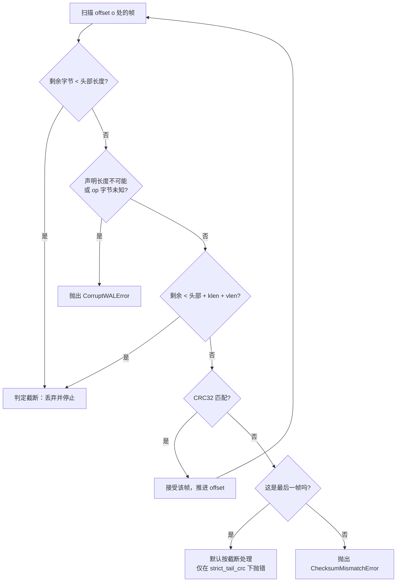
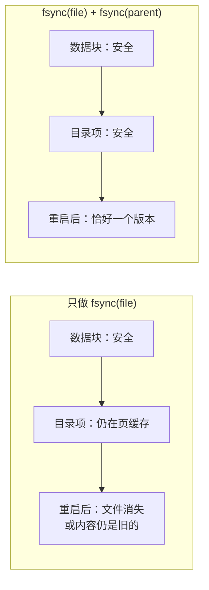
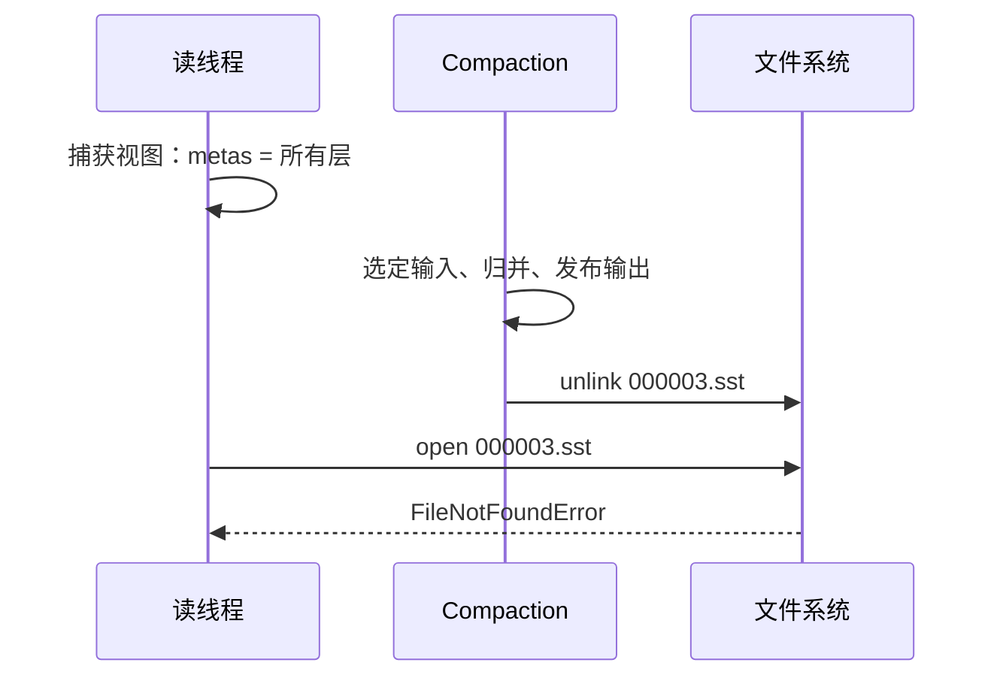
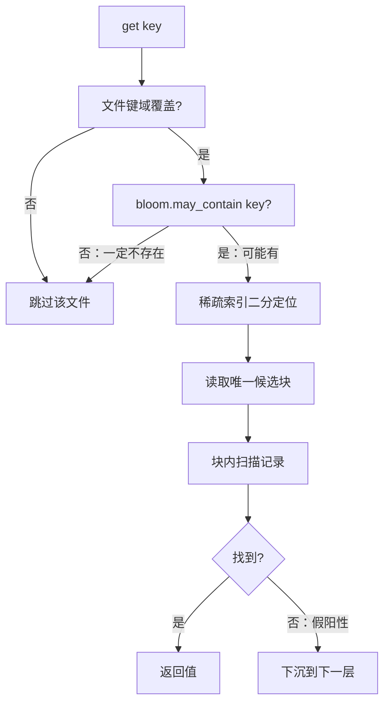

# 存储引擎硬核追问与深度解答

围绕预写日志、原子落盘、并发控制、墓碑与 Bloom Filter 的九个问题。每一个回答都锚定到本仓库的真实代码——给出文件与符号名，是为了让结论可被核对，而不是被相信。

配套文档：[`../skills/wal-and-recovery.md`](../skills/wal-and-recovery.md)、
[`../skills/atomic-flush.md`](../skills/atomic-flush.md)、
[`../skills/concurrency-control.md`](../skills/concurrency-control.md)。
English version: [`interview-qa-en.md`](interview-qa-en.md)。

---

## 1. 预写日志与崩溃恢复

### Q1. 为什么 `sable` 的 WAL 要用 CRC32 + 长度前缀的定长帧结构？直接存 JSON 行不行？

能存，而且它会一直工作到崩溃发生的那一刻。帧结构存在的意义，是让一个具体的问题**可判定**：**尾部这段垃圾，究竟是没写完的半截，还是落盘之后被改坏的数据？**

帧格式是 `struct.Struct("<IQBII")`——crc32、sequence、op、klen、vlen——21 字节定长头，后面跟 `klen + vlen` 字节的载荷（`src/sable/wal.py` 的 `encode_frame`）。由此直接得到两个设计后果：

**字节流自描述。** 从任意偏移量都能算出下一帧的起点，不需要外部索引。扫描器就是一个 `while offset < total` 循环。没有"重新同步"这一步，因为不存在需要同步的对象——长度前缀本身就是权威。

**"完整与否"是一次整数比较。** 拿到 `klen` 和 `vlen`，扫描器在读取载荷之前就知道这一帧是否放得下：

```python
frame_bytes = FRAME_HEADER_SIZE + klen + vlen
if remaining < frame_bytes:
    result.discarded_bytes += remaining
    result.torn_tail = True
    break
```

换行分隔的 JSON 回答不了这个问题。`{"k": "a` 是十个字节的语法不完整 JSON，而"解析失败"与"值本身就是畸形"无法区分。要判断截断还是损坏，你只能去解析，而解析恰恰是半截写入最能击败的手段。最终你还是要把显式长度字段加回来——那就成了"长度前缀信封里包着 JSON"，两边的代价都付了一遍。

另外两个理由没那么根本，但也不是无关紧要：

- **字节安全性。** 这里的键与值是任意字节。文本格式要求载荷永不包含分隔符，于是每次写入都要转义或 base64 编码、每次读取都要解码——全部发生在引擎最热的循环里，而目的只是为了绕开帧格式自身的缺陷。
- **成本。** `struct.pack` 一次写入一个缓冲区；通用编码器每条记录都要分配中间 dict 与字符串。

CRC32 放在**最前面**且只覆盖它之后的所有字节，因此流式读取可以一趟前向算出摘要、无需回退 seek，并且能在为键和值分配切片之前就拒绝这一帧。

诚实的说法是：这不是"二进制比 JSON 快"，而是**自描述的定长头才是让恢复可被证明的前提**，而 JSON 无论付出多大代价都给不了这一点。详见 [`../skills/wal-and-recovery.md`](../skills/wal-and-recovery.md) §2。

### Q2. 截断（torn-tail）发生时，为什么直接丢弃而不是尝试修复？

因为没有什么可修的，而"修"这个动作本身会违反契约。

引擎遵循 **append-before-apply**：`Engine._stage_mutation` 先分配序列号，再追加并 fsync WAL 帧，之后才写入 memtable。一帧没有到达稳定存储，就意味着它从未向任何调用者确认过。丢弃它不是丢失已承诺的数据，而是拒绝凭空捏造未被承诺的数据。

所谓"修复"只能是以下三种之一：

- **补零填满空缺。** 你现在手里有一帧载荷全零的记录。这是一个合法的零长度值，还是一个真实字节曾经存在过的空洞？恢复结果无从判断，而 memtable 两种都会接受。
- **从 memtable 重建。** memtable 已经没了，进程死了。
- **猜长度。** 长度字段是唯一可能幸存的东西，而如果载荷没跟着落下来，这一帧按定义就是不完整的。

`fsync` 边界是引擎唯一能诚实划出的线，也是调用者唯一能推理的线：`put()` 返回意味着"这条数据能活过进程死亡"，没有任何更弱的解释。

确实存在引擎**拒绝丢弃**的情形，而这个区别才是真正有意思的部分：



**后面还有其它帧**时发生 CRC 失败，是崩溃解释不了的。日志只追加，文件系统不会对已完成的 `fsync` 重排序，所以"坏字节之后还有好字节"意味着这些字节是在落盘之后被改动的——位翻转、坏块、或者一次截断后又被追加的拷贝。那是已经承诺、并且已经丢失的数据，唯一诚实的回应是拒绝猜测。

**最后一帧**发生 CRC 失败则真的无法区分：长度字段落盘但载荷没落盘的半截写入，与一个恰好翻了一位的完整帧，在字节层面完全一样。没有任何测试能把它们分开。因此默认回答的是运维上真正有用的问题——"这个文件可以安全重放吗？"——答案是能；而 `strict_tail_crc=True` 则让审计场景选择大声失败。

修复动作本身在构造上就是幂等的：`valid_bytes` 是字节图像的纯函数，所以扫描两次得到同一个偏移，而 `truncate_torn_tail` 在已经满足条件时是空操作（`if valid_bytes >= size: return 0`）。因此"恢复可以安全地执行任意多次"，而这正是"可以安全地执行一次"的唯一依据。

---

## 2. 原子落盘

### Q3. `os.replace()` 已经是原子操作了，为什么上层还要对父目录 `fsync`？不调的话断电后会怎样？

`os.replace` 的原子性是**对并发读者**而言：他们要么看到旧文件，要么看到新文件，绝不会看到混合体。它解决的问题和 `fsync(parent)` 解决的不是同一个。

`replace` 是一次**目录项变更**，而目录项本身也是必须落到稳定存储的数据。`fsync(file)` 只覆盖了文件的数据块；从头到尾没有任何一步覆盖过"`000004.sst` → 某个 inode"这个映射本身。

跳过它，你会得到那个经典的、进程级 kill 测试永远测不出来的失败：

> 数据完好无损地持久化了，名字没有。

重启后，目录项可能仍然指向**旧 inode**——于是你的新 SSTable 静默消失，而 manifest 现在描述的文件内容是过期的；也可能整个目录项都不存在，尽管数据块就好好地躺在磁盘上、带着一个合法的 footer。在 `sable` 里 manifest 走的是同一条发布路径，所以丢失一个目录项意味着：要么 manifest 引用了不存在的文件，要么存在的文件没人引用。恢复代码无法分辨发生了哪一种，因为两者看起来都是"少了一个文件"。

同样的论证也适用于 `unlink`。删除一个退役 SSTable 同样是目录变更，这正是 `Engine._discard_retired_files` 批量删除、然后只调用一次 `_seal_home_directory()` 的原因。



剩下的细节，每一个都有各自的失败模式：

- **临时文件必须是同级兄弟。** `atomic_write_bytes` 用的是
  `target.with_name(target.name + ".tmp-sable")`。放到 `/tmp` 会让 rename 变成跨设备拷贝并抛 `EXDEV`。
- **用 `os.replace` 而不是 `os.rename`。** `rename` 在 Windows 上目标存在时会失败；`replace` 在两个平台都是原子覆盖。这里的每一次发布都是替换。
- **`flush` 与 `fsync` 都要。** `flush` 把字节从 Python 缓冲区推进内核；`fsync` 把它们从内核推进盘片。只做一个都不够。
- **失败要清理。** `except OSError` 分支在重新抛出前先删除临时文件，因此失败的发布不会在任何一个名字下留下残骸。

平台差异是明说的、不是藏着的：`fsync_directory` 捕获 `OSError` 后直接返回。Windows 上不支持对目录 `os.open`——`CreateFile` 打开目录需要 `FILE_FLAG_BACKUP_SEMANTICS`，而 `os.open` 不会传这个标志，因此原生 CPython 报 `EACCES`/13，POSIX 仿真层（MSYS2、Cygwin）报 `EINVAL`/22。规则是捕获 `OSError` 并用 `getattr(os, "O_DIRECTORY", os.O_RDONLY)` 做特性嗅探，绝不特判某一个 errno。在那里文件内容的持久性与替换的原子性依然成立，只是目录项刷盘这一环降级——两份 README 都明确写了这一点。
详见 [`../skills/atomic-flush.md`](../skills/atomic-flush.md)。

---

## 3. 并发与 Compaction

### Q4. 读操作期间突然触发 Compaction 删掉了旧 SSTable，正在读的线程为什么会报错？`sable` 怎么解决？

因为读者先解析到这个文件，然后文件不存在了，然后读者去打开它。具体过程：



在 Linux 上，失败往往**比报错更糟**：已经持有 fd 的读者会愉快地继续读那个被 unlink 的 inode，于是这个 bug 一直藏着，直到**另一个**读者去打开路径才拿到 `FileNotFoundError`——非确定性，且概率随读并发度上升。在 Windows 上，则是 `unlink` 本身抛 `PermissionError`，因为打开的句柄阻止删除。无论哪种，结果都是一个概率随负载变化的竞态。

`sable` 用**引用计数租约**解决它，而关键细节不是计数器本身，而是**它在什么时候自增**（`src/sable/engine.py` 的 `Engine._lease_view`）：

```python
with self._lock:
    tables = [self._active, *self._immutable]
    metas = [meta for level in self._levels for meta in level]
    for meta in metas:
        meta.pin()
```

**捕获视图**与**自增 `refs` 发生在同一个临界区内。** 把它们拆开，竞态就回来了：

```
读者:   解析 metas              compaction: 把 meta 从 _levels 摘掉
读者:   （还没 pin）            compaction: 观察到 refs == 0 -> unlink
读者:   pin()  ->  已经太晚
```

注意哪些东西**没有被持有**：只有一个列表推导和一轮整数自增。扫描本身完全在 `_lock` 之外运行。

Compaction 那一侧是对称的。安装输出时，它立刻把输入从版本集中移除，但**不一定**删除字节：

```python
if meta.refs > 0:
    self._pinned_obsolete.append(meta)   # 删除延后
    continue
(home / meta.file_name).unlink(missing_ok=True)
```

`_pinned_obsolete` 就是待删墓地。最后一个 unpin 的读者触发 `_discard_retired_files`，它把所有 `refs` 归零的文件真正删除，并返回清单，好让父目录只 fsync 一次。

净效果是：Compaction 的**逻辑**结果立即生效（文件立刻离开版本集），而只有它的**物理**结果被延后（字节在最后一个租约到期时才消失）。这严格弱于排他访问，也严格更实用：长扫描永远不会拖慢 Compaction，Compaction 也永远不会拖慢写入者。

这个机制用 `@contextlib.contextmanager` 实现，因此一个中途被放弃的扫描——消费方 `break`，或被 `limit` 提前终止——在生成器被关闭时依然会释放租约。

还有一个**独立的第二类问题**，文件租约解决不了：归并本身可能丢弃某个活跃快照仍有权读到的版本。那是由序列区间（sequence bands）而不是引用计数处理的，见 Q6 与
[`../skills/concurrency-control.md`](../skills/concurrency-control.md) §3。

### Q5. 为什么采用手动 Compaction 而不是后台线程自动触发？工程权衡是什么？

`Engine.compact()` 是一次显式调用。memtable 越过预算会同步触发 flush，而这条路径会调用 `_maybe_compact()`——但没有 compactor 线程，没有队列，没有定时器。

理由按重要性排列：

**1. 失败模式保持可观测。** 后台 compactor 抛异常时无处上报。它要么静默死掉（树缓慢劣化且毫无信号），要么在一个永远解析不了的输入上无限重试。同步调用时，Compaction 的失败就在导致它的那个线程里、在那个导致它的点上抛出。对于一个以"正确性可验证"为全部主张的引擎来说，"某个离线程的地方出了错而树还在跑"是不可接受的结局。

**2. 测试变得确定性。** 崩溃矩阵与竞态套件需要知道 Compaction 到底发生了没有。有了后台调度器，每个测试都需要同步点或 sleep；有了显式调用，`engine.compact()` 返回 `True` **本身就是**同步点。`tests/test_concurrent.py` 用 `threading.Barrier` 让 Compaction 与扫描真实并发并对结果断言——面对一个不透明的调度器，这根本无法可靠地写出来。

**3. CPython 让收益比看起来小。** Compactor 线程与它想并行的写入者共享同一个 GIL。它买到的是 I/O 上的重叠，不是 CPU 上的，而归并本身是 `heapq.merge` 驱动的 CPU 密集 Python 代码。你真正得到的是一个在不可预测的时刻争抢 GIL 的线程，外加全部生命周期复杂度。

**4. 背压用阈值表达更合适。** `EngineOptions` 带有 `level0_file_num_compaction_trigger`、`level0_slowdown_trigger` 与 `l1_bytes_trigger`。想要自动化的调用者自己在维护线程里 `while engine.compact(): pass`；想要确定性的调用者就调一次。策略归使用者所有。

代价是真实的，应当明说：一个从不调用 `compact()` 的重写入负载会累积重叠的 L0 文件，读放大随之增长。`_maybe_compact()` 在预算触发的 flush 之后机会性地缓解这一点——而且它用的是 `acquire(blocking=False)`，所以抢不到锁的写入者直接返回而不是排队。持有 compactor 槽位的那个线程，正在重写的恰恰就是这个调用者本来会选中的文件；阻塞换不来任何东西，只会把一次吞吐尖峰变成一串车队。

---

## 4. 墓碑与内存快照

### Q6. 为什么删除数据时不能直接去磁盘上把那条记录抹掉，而要写一个 tombstone？

因为 LSM 树是分层的，而你必须遮蔽的那个版本，往往**不在**你本来要改的那个文件里。

```
L0  000007.sst   [ ..., k=v3, ... ]     <- 删除本该落在这里
L1  000002.sst   [ ..., k=v1, ... ]     <- 过期版本真正待的地方
L2  000001.sst   [ ..., k=v0, ... ]
```

要物理抹掉这条记录，你得先找出 `v1` 和 `v0` 并重写两个文件。这是每次删除都要做的一次随机多文件重写——恰恰是 LSM 树存在的意义所要避免的写放大。更糟的是，这些文件按契约是不可变的：读者持有它们的租约，原地修改会破坏"文件要么完整要么不存在"这条让崩溃恢复可被证明的性质。

墓碑就是一条 `OpType.DELETE` 的普通追加。它只花一帧 WAL 和一个 memtable 条目，与其它一切共用同一套序列号排序，并且通过**正常的读路径**生效：归并看到 `k=tombstone@seq 9` 排在 `k=v1@seq 2` 之前，认定它是胜出版本，于是返回 `None`。删除由此从"写路径的挖掘"变成了"读路径的推论"。

微妙之处在于墓碑是承重的、不能被过早回收。`src/sable/compaction.py` 只在两个条件**同时**成立时才丢弃它：

- 输出落在**最深一层**，因此下方不可能还有需要遮蔽的版本；且
- **该标记下方没有任何被保留的版本**——因为如果某个活跃快照让一个更老的版本活了下来，丢弃墓碑就会让被删的值对后续读者"复活"。

`tests/test_concurrent.py::test_visible_versions_keeps_a_tombstone_that_still_masks_something`
正是钉住这个情形的用例。弄错它是这里少数几个会**静默损坏可见状态**、而不仅仅是浪费空间的错误之一。

### Q7. 读路径如何保证活跃 MemTable 的读写互斥，同时让 Scan 拿到一致性视图？

这是两种不同的保证，由两种机制分别承担。

**互斥是"每张表一把锁"且极短。** 每个 `MemTable` 拥有自己的 `threading.Lock`（`_mutation`），与引擎的 `_lock` 相互独立。`add`、`get`、`freeze`、`key_edge_slice` 只在操作本身期间持有它——一次跳表下降或一次链接。因此向活跃 memtable 插入的写入者既不与引擎状态争抢，也不与读**另一张** memtable 的读者争抢。

**一致性来自"物化一个窗口"。** `iter_range` **不**在 yield 期间持有锁：

```python
with self._mutation:
    nodes = list(self._nodes_in(key_range))
return (node.entry for node in nodes)
```

命中的节点在结构锁下被收集完毕，生成器随后在无锁状态下遍历这份列表。这是答案里最重要的那一半。**跨生成器持锁**，正是许多引擎不小心把"所有读"串行化到"所有写"之后的原因——一次大范围扫描会在它的整个持续期内阻塞全部写入者。在锁下物化窗口、在锁外遍历，既给了扫描一组连贯的节点，又让它保持非阻塞。

**引擎层面的连贯性还需要一件事。** 扫描绝不能观察到"不可变 memtable 已被摘掉、但替代它的 SSTable 还没挂上"这样一棵树。`Engine._lease_view` 在同一次 `_lock` 获取内捕获 `[self._active, *self._immutable]` 以及每一层的 metas，并在同一个临界区内 pin 住文件。一把锁、一次全源快照——视图由构造保证连贯，而不是靠顺序运气。

合起来，值得单独说出来的性质是：

> 写入者可以在一次扫描迭代到一半时向活跃 memtable 插入数据。扫描既不阻塞它，也不会看到某个链接了一半的节点；它只是看不到序列号高于自己所物化窗口的那些条目。

在此之上的快照隔离几乎免费：`Engine.snapshot()` 只记录 `self._last_sequence`，不复制任何数据。通过该视图的读过滤掉更高的序列号；后续写入只是携带更大的编号而已。

---

## 5. Bloom Filter

### Q8. 解释 double-hashing 的参数配置；为什么 Bloom Filter 只能判定"绝对不存在"，而无法替代真实磁盘索引的二分查找？

**几何参数。** 两个旋钮，都是算出来的而不是拍出来的（`src/sable/bloom.py`）：

```python
m = -n * ln(p) / (ln 2)^2          # optimal_bit_width
k = round((m / n) * ln 2)          # optimal_probe_count，钳制到 [1, 32]
```

给定预期键数 `n` 与目标误判率 `p`，`m` 位在给定空间预算下使误判率最小，`k` 次探测在给定 `m` 下使误判率最小。`p = 0.01` 时约为每键 9.6 位、`k = 7`。`sable` 在写入时通过 `BloomFilter.with_capacity` 由 `num_entries` 推导两者，因此过滤器是按它真正所描述的那个文件来定尺寸的，而不是用一个全局常量。

`k` 被钳制到 `[1, 32]`，以免病态的 `m/n` 把一次查询变成上千次探测；`m` 下限为 8 位，以免极小的过滤器在结构上失真。

**哈希。** 两个 FNV-1a 64 位摘要通过 double hashing 派生 `k` 个探测位：

```python
digest_a = _fnv1a(key, _FNV_OFFSET_A)
digest_b = _fnv1a(key, _FNV_OFFSET_B) | 1   # 保证为奇数，与 m 互素
return [(digest_a + step * digest_b) % width for step in range(probes)]
```

这是 Kirsch–Mitzenmacher 方案：`h1 + i*h2 mod m` 用两次摘要的代价换来 `k` 次探测，并保住了误判率分析所依赖的独立性假设。`digest_b` 被强制为奇数，是为了与 `m` 互素，避免探测点塌陷到一个短循环上。之所以用 FNV-1a 而不是密码学摘要，是因为过滤器比特本身就会泄漏成员信息，而读路径最热的循环里为抗碰撞性付费纯属浪费。

**为什么只能判定"绝对不存在"。** 因为插入在一个方向上是单向有损的：

- **被插入过**的键把它的 `k` 个位全置上了，这些位不会消失。因此对于插入过的键，否定回答不可能出现——**没有假阴性**。
- **没被插入**的键，它的 `k` 个位也可能被其它键的插入全部置上。因此肯定回答只意味着"可能有"——**假阳性是固有的**。

这个不对称性就是它的全部价值，并且与读路径的需求严丝合缝。按"否"剪枝永远安全；"是"的情况则落到真正的查找上，而那才是权威的。没有任何东西被丢失，只是省掉了一些工作。



**为什么它替代不了索引。** Bloom Filter 回答的是**成员性**问题，而读路径需要的是**位置**。它告诉你这个键大概在这个文件里，但对"在哪个块"一言不发——所以你仍然得搜，而且没有索引就只能逐块扫。稀疏索引（每 4 KiB 块一行：offset、size、CRC、first key）才是把"大概在这"变成"就在这个块"的东西，代价是 `O(log 块数)` 且完全不产生 I/O。

两者互补，实测也印证了这一点：在已归档的基准里，不存在的键是 122k ops/sec，存在的键是 21k——因为未命中路径从不读取数据块，而命中路径永远恰好读一个。过滤器根本产生不出命中那个结果——只有索引能。

两者的失效方式也不同，这正是两者都要带校验和的原因。过滤器损坏会产生假阴性，那是静默的数据丢失；而数据块与索引各自携带 CRC32，因此一次坏读会抛错，而不是返回"没有"。
