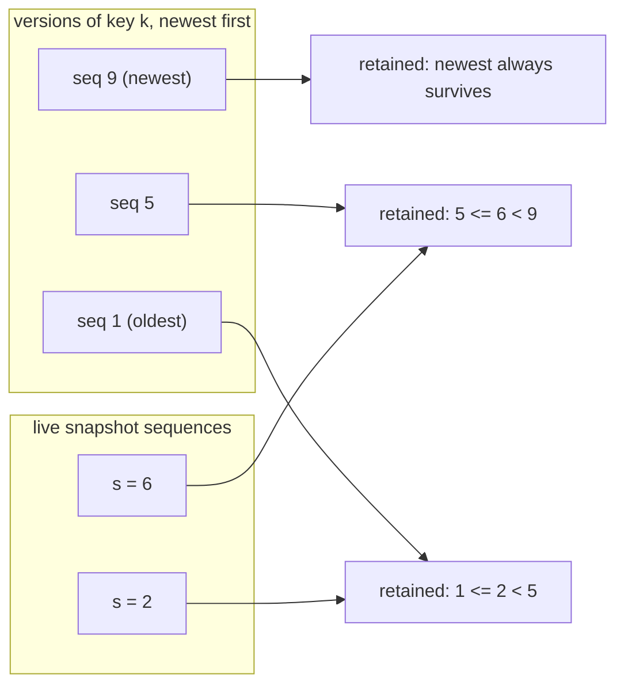

# Concurrency Control: File Leases, Snapshots and Deterministic Race Tests

How `sable` keeps a compaction from pulling a file out from under a reader, how
the lock set stays deadlock-free, and how to write multi-threaded tests that
actually reproduce the race instead of merely hoping to.

Reference: `src/sable/engine.py`, `src/sable/memtable.py`,
`src/sable/compaction.py`, `tests/test_concurrent.py`.

---

## 1. The problem, stated precisely

Compaction reads a set of SSTables, merges them, publishes the outputs, and then
deletes the inputs. A concurrent scan may be holding an open reader on one of
those inputs.

Two distinct things can go wrong, and they need different mechanisms:

1. **The file disappears mid-read.** The scan has a `SSTableReader` whose fd
   points at an unlinked inode. On POSIX the read still works (the inode
   survives); on Windows the unlink fails; and either way the *next* reader that
   opens the same path gets `FileNotFoundError`. This is a lifecycle problem.
2. **A version the reader is entitled to gets merged away.** Even if the file
   stays, the merge may drop a version that a live snapshot can still see. This
   is a visibility problem, and no amount of file pinning fixes it.

`sable` uses reference counts for (1) and sequence bands for (2). They are
independent on purpose.

---

## 2. Mechanism one: reference-counted file leases

### The lease

```python
@contextlib.contextmanager
def _lease_view(self):
    with self._lock:
        tables = [self._active, *self._immutable]
        metas = [meta for level in self._levels for meta in level]
        for meta in metas:
            meta.pin()          # refs += 1
    try:
        yield tables, metas
    finally:
        expired = [meta for meta in metas if meta.unpin() == 0]
        if expired:
            self._release_retired(expired)
```

The critical detail is that **capturing the view and incrementing `refs` happen
in the same critical section.** Split them and you reintroduce the bug:

```
reader:  resolve metas          compaction: drop meta from _levels
reader:  (not yet pinned)       compaction: observe refs == 0 -> unlink
reader:  pin()  -> too late, the file is gone
```

Correctness here is not about the lock being held for a long time — it is about
the two operations being *atomic with respect to each other*. The lock is held
for one list comprehension and one loop of integer increments; the actual scan
runs entirely outside it.

`contextlib.contextmanager` is used rather than explicit try/finally at each
call site so that a generator abandoned mid-iteration still releases the lease
when the GC closes it. A scan that is short-circuited by `limit` or by a
consumer `break` must not leak references.

### Retirement

When compaction installs its outputs it removes the input metas from the version
set but does not necessarily delete the bytes:

```python
if meta.refs > 0:
    self._pinned_obsolete.append(meta)   # deletion waits
    continue
(home / meta.file_name).unlink(missing_ok=True)
```

`_pinned_obsolete` is the graveyard. The last reader to unpin triggers
`_discard_retired_files`, which unlinks everything in the graveyard whose
`refs` reached zero and returns the list so the directory can be fsync-ed once
for the batch.

### Why not a reader-writer lock

An `RWLock` around the file set would also prevent the unlink. It costs more and
buys less:

| | Reference counts | RWLock |
|---|---|---|
| Reader/reader concurrency | Unaffected — pinning is one integer per file, no waiting | Either blocks on a shared acquisition or needs its own reader registry |
| Compaction latency | Unaffected by readers; it drops the file from the view immediately and defers only the unlink | Compaction holds the write side, so it waits for every in-flight reader to finish |
| Failure mode if a reader stalls | Bytes linger until released; readers and writes proceed | The compactor stalls behind the stalled reader |
| Interaction with long scans | A scan over a large range holds a lease, not a lock | A long scan holds the read side for its whole duration |

Reference counting turns "exclusive access" into "deferred reclamation", which
is the weaker and more appropriate guarantee: compaction's *logical* effect (the
file leaves the version set) is immediate, and only its *physical* effect (the
bytes go away) waits.

### Why not GC / finalisers

Deleting a file when its reader object is collected makes deletion timing a
function of the garbage collector, which differs between CPython, PyPy, and
future CPython versions. An explicit lease makes the lifetime observable,
testable, and independent of interpreter implementation.

---

## 3. Mechanism two: snapshot sequence bands

`Engine.snapshot()` records `self._last_sequence` and nothing else. No data is
copied. Later writes carry strictly higher sequences, so the view filters them
out at read time.

Compaction must therefore not drop a version that some live view can still see.
`visible_versions` in `src/sable/compaction.py` reasons in bands: for each key,
version `v` is retained if some live snapshot sequence `s` satisfies
`lower(v) <= s < upper(v)` — that is, if `v` is the newest version that `s` could
observe.



With no live snapshots the band is empty for every elder version and they are
dropped as before — the policy costs nothing when nobody is looking.

The corresponding tombstone rule is the subtle one: **a tombstone may be dropped
only if no retained version sits below it.** If an elder version survives for a
snapshot, dropping the marker would resurrect the deleted value for any *newer*
reader that consults the same file. `visible_versions` checks this explicitly,
and `tests/test_concurrent.py::test_visible_versions_keeps_a_tombstone_that_still_masks_something`
pins it.

---

## 4. The lock set

Three locks, three jobs:

| Lock | Protects | Held while |
|---|---|---|
| `_lock` (RLock) | All engine state: levels, memtables, readers, snapshots, WAL | Short sections only |
| `_flush_lock` | Serialises memtable freeze + SSTable publish | Not held during file I/O |
| `_compaction_lock` | Serialises compaction jobs | Not held during merge |

The rules that keep it deadlock-free:

1. **Single acquisition order.** `_flush_lock` and `_compaction_lock` are taken
   outermost, `_lock` innermost. `close()` takes all three in one statement
   (`with self._flush_lock, self._compaction_lock, self._lock`), which is the
   one place that holds more than one.
2. **No engine method calls another while holding a maintenance lock.** Nothing
   calls `flush()` from inside `compact()` or vice versa.
3. **Expensive work runs unlocked.** `_seal_one_immutable` freezes and swaps the
   memtable under `_lock`, then writes the SSTable with no lock held at all —
   the new file is invisible until the manifest names it, so excluding readers
   during the write would buy nothing. Only the plan and the install in
   `_compact_once` take `_lock`; the merge reads immutable inputs and writes a
   file nobody has referenced yet.
4. **Contention is lost, not queued.** `_seal_over_budget` and `_maybe_compact`
   use `acquire(blocking=False)`. A writer that loses the race simply returns:
   the winner's work covers their entries too, so blocking would buy nothing and
   would turn a throughput spike into a convoy.
5. **MemTable mutation is its own lock.** `MemTable._mutation` is a separate
   short-lived lock so a writer inserting into the skip list never contends with
   engine state. Range iteration snapshots the node window under that lock and
   then walks outside it, so a long scan never blocks writers.

Point 5 is the one that is easy to get wrong. Holding a lock across a *generator*
is how engines accidentally serialise all reads behind all writes; holding it
only across "resolve the window" is what keeps a scan non-blocking while still
giving it a coherent set of nodes.

---

## 5. Writing deterministic race tests with `threading.Barrier`

A test that starts threads and joins them proves nothing about interleavings —
it usually just runs them sequentially. `threading.Barrier` forces every worker
to arrive at the same point before any proceeds, which is the difference between
"we hope they overlapped" and "they provably overlapped".

### The pattern

```python
def test_scan_completes_while_compaction_retires_its_files(tmp_path):
    engine = Engine.open(...)
    gate = threading.Barrier(2)          # one party per worker

    def scan_worker():
        gate.wait(timeout=THREAD_TIMEOUT_SECONDS)
        for _ in engine.scan():
            pass

    def compact_worker():
        gate.wait(timeout=THREAD_TIMEOUT_SECONDS)
        engine.compact()

    run_in_threads(scan_worker, compact_worker)   # joins with a timeout
```

Every barrier in `tests/test_concurrent.py` is created with `parties` equal to
the number of workers. Never count the coordinator: if the main thread also
calls `wait()`, it becomes a party and the count changes.

### Rules that keep these tests from hanging

| Rule | Reason |
|---|---|
| Always pass `timeout=` to `wait()` | A bug in the code under test turns a hang into `BrokenBarrierError` (a failure) instead of a test suite that never finishes. |
| Never hold a lock across `wait()` | The other parties cannot arrive, and the barrier deadlocks by construction. Release first, then wait. |
| Join with a timeout, then assert the thread finished | `thread.join(timeout)` returning does not mean the thread ended; check `is_alive()` before trusting the result. |
| Assert on an invariant, not on an interleaving | "The scan completed and saw N keys" is stable. "The scan saw the pre-compaction value" depends on scheduling and will flake. |
| Close the engine in a `finally` | A worker that raises leaves the database open and the reader fds pinned. |

### What to assert

The valuable assertions are the ones that fail only when the mechanism is broken:

- **No exception at all** from the concurrent reader. `FileNotFoundError` here
  means the lease was not taken before the unlink.
- **`versions_of(engine, key) == 1` after releasing every snapshot** — proving
  retention actually released what it retained, rather than leaking versions
  forever.
- **A snapshot taken before a delete still sees the tombstone** — proving the
  band logic, not just the file pinning.
- **A retired file still exists on disk while a walk holds it** — asserting the
  observable consequence of the lease rather than an internal counter.

`tests/test_concurrent.py` runs twelve such cases. Each is executed repeatedly
during development; a race test that passes once is a coincidence, so the suite
is run several times back to back before a change is considered safe.

### Debugging a hanging race test

1. Check party counts first — a mismatch is the most common cause.
2. Look for a lock held across `wait()`.
3. `faulthandler.dump_traceback_later()` will tell you which thread is stuck and
   on what, which is far faster than bisecting.
4. If it only hangs under `pytest -n`, remember that barriers synchronise
   threads, not processes; worker threads must live in the same interpreter.

---

## 6. Checklist

- [ ] View capture and `refs` increment are atomic with respect to each other.
- [ ] Leases release on every exit path, including generator abandonment.
- [ ] Deletion is deferred to a graveyard, then batched with one directory fsync.
- [ ] Version retention and tombstone retention are both snapshot-aware.
- [ ] Maintenance work (file I/O, merging) runs outside the state lock.
- [ ] Exactly one lock acquisition order; `close()` is the only multi-lock site.
- [ ] Contention is non-blocking where losing the race is free.
- [ ] Every race test uses a barrier with a timeout and joins with a timeout.
- [ ] Assertions target invariants, not specific interleavings.

---

## 7. Where to read next

| Concern | Source |
|---|---|
| Leases, retirement, lock set | `src/sable/engine.py` |
| Version/tombstone retention bands | `visible_versions` in `src/sable/compaction.py` |
| MemTable structure lock | `src/sable/memtable.py` |
| Twelve barrier-driven race tests | `tests/test_concurrent.py` |
| Atomic publish of the files being leased | `docs/skills/atomic-flush.md` |
