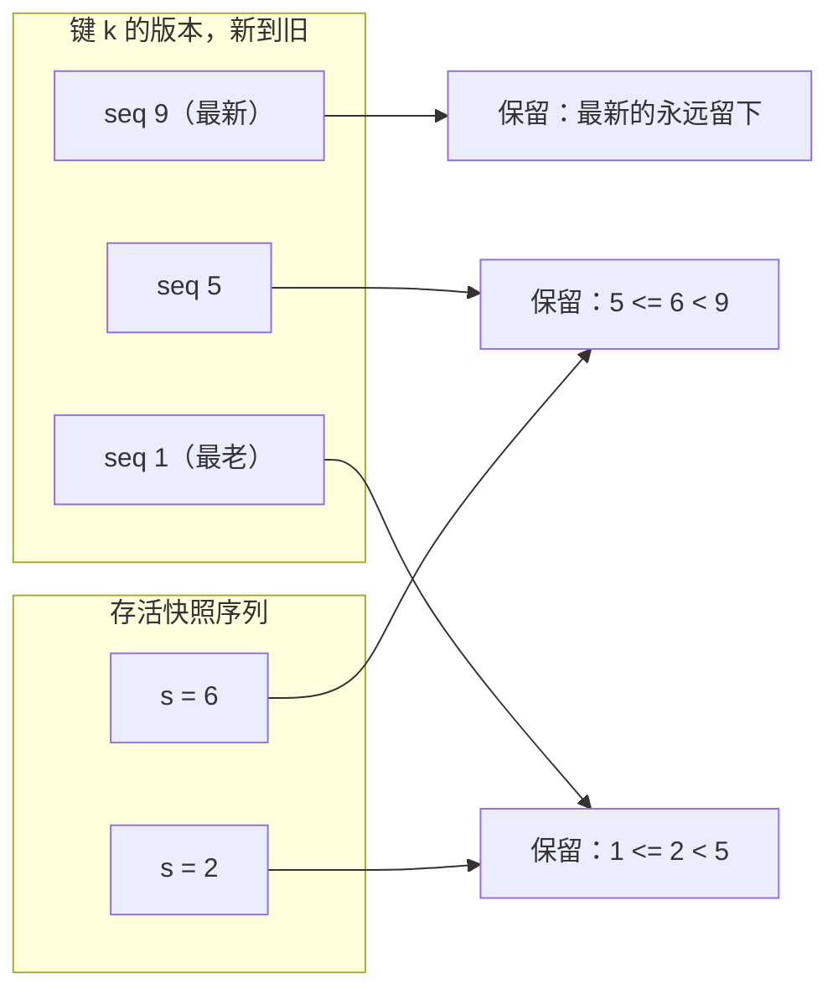

[English](concurrency-control.md) | [简体中文](concurrency-control.zh-CN.md)

# 并发控制：文件租约、快照与确定性竞态测试

`sable` 怎么让 compaction 不从 reader 脚下把文件抽走，锁集合怎么保持无死锁，以及怎么写真正能复现
竞态、而不只是盼着它发生的多线程测试。

参考：`src/sable/engine.py`、`src/sable/memtable.py`、`src/sable/compaction.py`、
`tests/test_concurrent.py`。

---

## 1. 把问题说精确

compaction 读一组 SSTable、归并、发布输出，然后删掉输入。而一次并发 scan 可能正握着其中某个
输入上打开的 reader。

有两件不同的事会出错，需要两套机制：

1. **文件在读到一半时消失。** scan 手里那个 `SSTableReader` 的 fd 指向一个已被 unlink 的 inode。
   POSIX 上读还能继续（inode 还在）；Windows 上 unlink 会失败；而两种情况下，*下一个*打开同一
   路径的 reader 都会拿到 `FileNotFoundError`。这是生命周期问题。
2. **reader 有权读取的版本被归并掉了。** 即便文件还在，归并也可能丢掉一个存活快照仍看得见的
   版本。这是可见性问题，钉住文件再多次也修不了。

`sable` 用引用计数处理 (1)，用序列带处理 (2)。两者刻意互相独立。

---

## 2. 机制一：引用计数的文件租约

### 租约

```python
@contextlib.contextmanager
def _lease_view(self):
    with self._lock:
        tables = [self._active, *self._immutable]
        metas = [meta for level in self._levels for meta in level]
        for meta in metas:
            meta.pin()          # refs += 1
    try:
        yield tables, metas
    finally:
        expired = [meta for meta in metas if meta.unpin() == 0]
        if expired:
            self._release_retired(expired)
```

关键的细节是**抓取视图和递增 `refs` 发生在同一段临界区里**。拆开就把 bug 请回来了：

```
reader:  resolve metas          compaction: drop meta from _levels
reader:  (还没 pinned)          compaction: 看到 refs == 0 -> unlink
reader:  pin()  -> 太晚了，文件已经没了
```

这里的正确性不在于锁被握得久，而在于两个操作*彼此原子*。锁只握着一个列表推导和一轮整数自增；
真正的 scan 完全在锁外跑。

用 `contextlib.contextmanager` 而不是在每个调用点写 try/finally，是为了让迭代中途被丢弃的
生成器在 GC 关闭它时仍然释放租约。被 `limit` 提前截断、或被消费者的 `break` 打断的 scan，
绝不能泄漏引用。

### 退役

compaction 安装输出时，把输入 metas 从版本集里拿掉，但不一定删字节：

```python
if meta.refs > 0:
    self._pinned_obsolete.append(meta)   # 删除往后推
    continue
(home / meta.file_name).unlink(missing_ok=True)
```

`_pinned_obsolete` 就是墓地。最后一个 unpin 的 reader 触发 `_discard_retired_files`，把墓地里
`refs` 归零的东西全部 unlink，并返回列表，好让目录整批只 fsync 一次。

### 为什么不用读写锁

给文件集套一把 `RWLock` 也能挡住 unlink。它付得更多、买得更少：

| | 引用计数 | RWLock |
| --- | --- | --- |
| reader / reader 并发 | 不受影响——pin 只是每个文件一个整数，不等待 | 要么卡在共享获取上，要么得自己维护一份 reader 登记表 |
| compaction 延迟 | 不受 reader 影响；它立刻把文件从视图里拿掉，只把 unlink 往后推 | compaction 握着写侧，于是要等所有在飞的 reader 结束 |
| 某个 reader 卡住时的失效方式 | 字节多留一会儿；reader 和写入照常 | compactor 堵在那个卡住的 reader 后面 |
| 与长 scan 的相处 | 大范围 scan 持有一份租约，不是一把锁 | 长 scan 在整个持续期握着读侧 |

引用计数把「独占访问」换成「延迟回收」，后者是更弱、也更恰当的保证：compaction 的*逻辑*效果
（文件离开版本集）立刻生效，只有它的*物理*效果（字节消失）要等。

### 为什么不用 GC / finaliser

reader 对象被回收时才删文件，等于让删除时机变成垃圾回收器的函数，而 CPython、PyPy 和未来的
CPython 版本各不相同。显式租约让生命周期可观察、可测试，并且与解释器实现无关。

---

## 3. 机制二：快照序列带

`Engine.snapshot()` 只记下 `self._last_sequence`，别的什么都不做，不复制任何数据。之后的写入
带着严格更大的 sequence，于是视图在读的时候把它们过滤掉。

因此 compaction 绝不能丢掉某个存活视图仍看得见的版本。`src/sable/compaction.py` 里的
`visible_versions` 按「带」来推理：对每个键，只要存在某个存活快照序列 `s` 满足
`lower(v) <= s < upper(v)`——也就是 `v` 恰好是 `s` 能观察到的最新版本——版本 `v` 就被保留。



没有存活快照时，每个更老版本的带都是空的，于是照旧被丢掉——没人看着的时候，这套策略不花
任何成本。

对应的墓碑规则才是微妙的那条：**只有当它下面没有任何被保留的版本时，墓碑才可以被丢掉。**
如果某个更老版本为了一个快照而留下，丢掉这个标记会让任何*更新*的、查同一份文件的 reader
看到那个被删的值复活。`visible_versions` 显式检查了这一点，
`tests/test_concurrent.py::test_visible_versions_keeps_a_tombstone_that_still_masks_something`
把它钉住了。

---

## 4. 锁集合

三把锁，三份职责：

| 锁 | 保护什么 | 握着的时候 |
| --- | --- | --- |
| `_lock`（RLock） | 所有引擎状态：层级、memtable、reader、快照、WAL | 只在短临界区 |
| `_flush_lock` | 串行化 memtable 冻结 + SSTable 发布 | 文件 I/O 期间不持有 |
| `_compaction_lock` | 串行化 compaction job | 归并期间不持有 |

让它保持无死锁的规则：

1. **唯一的获取顺序。** `_flush_lock` 和 `_compaction_lock` 在最外层，`_lock` 在最内层。
   `close()` 用一条语句同时拿三把（`with self._flush_lock, self._compaction_lock, self._lock`），
   这是唯一一处持有不止一把的地方。
2. **握着维护锁时，任何引擎方法都不调用另一个。** 没有谁在 `compact()` 里调 `flush()`，反之亦然。
3. **贵的活不加锁地跑。** `_seal_one_immutable` 在 `_lock` 下冻结并换掉 memtable，然后完全不持
   锁地写 SSTable——新文件在 manifest 点名它之前是不可见的，所以写的时候把 reader 挡在外面
   什么也买不到。`_compact_once` 里只有规划和安装拿 `_lock`；归并读的是不可变输入、写的是
   还没被任何人引用的文件。
4. **竞争是「丢了」，不是「排队」。** `_seal_over_budget` 和 `_maybe_compact` 用
   `acquire(blocking=False)`。抢不到的 writer 直接返回：赢家做的活儿也覆盖了它的条目，阻塞
   既买不到什么，又会把一次吞吐尖峰变成一队人等。
5. **MemTable 的变更有自己的锁。** `MemTable._mutation` 是一把独立的短命锁，于是往跳表里插
   数据的 writer 不会和引擎状态竞争。范围迭代在这把锁下给节点窗口拍个快照，然后到锁外去走，
   所以一次长 scan 从不阻塞 writer。

第 5 点是最容易写错的。让一把锁跨过*生成器*，正是引擎不小心把所有读串行到所有写后面的方式；
只在「解析窗口」这步握着它，才是既让 scan 不阻塞、又给它一套连贯节点的做法。

---

## 5. 用 `threading.Barrier` 写确定性竞态测试

一个「起几个线程再 join」的测试证明不了任何关于交错的事——它通常只是把它们顺序跑了一遍。
`threading.Barrier` 强制每个 worker 都到齐同一个点之后才放行，这就是「我们希望它们重叠了」和
「它们可证明地重叠了」的差别。

### 范式

```python
def test_scan_completes_while_compaction_retires_its_files(tmp_path):
    engine = Engine.open(...)
    gate = threading.Barrier(2)          # 每个 worker 占一方

    def scan_worker():
        gate.wait(timeout=THREAD_TIMEOUT_SECONDS)
        for _ in engine.scan():
            pass

    def compact_worker():
        gate.wait(timeout=THREAD_TIMEOUT_SECONDS)
        engine.compact()

    run_in_threads(scan_worker, compact_worker)   # 带超时地 join
```

`tests/test_concurrent.py` 里每个 barrier 的 `parties` 都等于 worker 数。千万别把协调者算进去：
主线程如果也调 `wait()`，它就成了其中一方，计数就变了。

### 让这些测试不挂住的规则

| 规则 | 理由 |
| --- | --- |
| `wait()` 永远传 `timeout=` | 被测代码里的 bug 会把一次挂起变成 `BrokenBarrierError`（一个失败），而不是一个永远跑不完的套件。 |
| 绝不握着锁跨过 `wait()` | 其他方到不了，barrier 按构造就死锁了。先释放，再等。 |
| 带超时 join，然后断言线程真的结束了 | `thread.join(timeout)` 返回不代表线程结束了；相信结果之前先查 `is_alive()`。 |
| 断言不变量，不断言某一种交错 | 「scan 完成了、看到了 N 个键」是稳定的。「scan 看到了 compaction 之前的值」取决于调度，会 flake。 |
| 在 `finally` 里关引擎 | 抛异常的 worker 会把数据库留着打开、reader 的 fd 钉着不放。 |

### 该断言什么

有价值的断言，是那些只在机制坏了才会挂的：

- 并发 reader **一次异常都不抛**。这里出现 `FileNotFoundError`，说明租约没在 unlink 之前取到。
- **释放掉每个快照之后 `versions_of(engine, key) == 1`** —— 证明保留机制真的把它留住的东西
  放了，而不是永远泄漏版本。
- **删除之前取的快照仍然看得见那个墓碑** —— 证明的是带的逻辑，不只是文件 pin。
- **一次 walk 握着某个已退役文件时，它在盘上仍然存在** —— 断言租约的可观察后果，而不是
  一个内部计数器。

`tests/test_concurrent.py` 跑了十二个这样的用例。开发期间每个都会反复执行；竞态测试过一次是巧合，
所以一次改动被认为安全之前，套件会连着跑好几遍。

### 调试挂住的竞态测试

1. 先查 party 数——对不上是最常见的原因。
2. 找有没有锁跨过了 `wait()`。
3. `faulthandler.dump_traceback_later()` 会告诉你是哪个线程卡在哪儿，比二分快得多。
4. 如果只在 `pytest -n` 下挂，记住 barrier 同步的是线程、不是进程；worker 线程必须活在同一个
   解释器里。

---

## 6. 检查清单

- [ ] 抓取视图与递增 `refs` 彼此原子。
- [ ] 每条退出路径都释放租约，包括生成器被丢弃。
- [ ] 删除推迟到墓地，再批量化、只做一次目录 fsync。
- [ ] 版本保留与墓碑保留都是快照感知的。
- [ ] 维护工作（文件 I/O、归并）跑在状态锁之外。
- [ ] 只有一种锁获取顺序；`close()` 是唯一的多锁点。
- [ ] 丢掉竞争没有代价的地方，用非阻塞获取。
- [ ] 每个竞态测试都用带超时的 barrier、带超时的 join。
- [ ] 断言对准不变量，不对准具体的交错。

---

## 7. 接着读哪儿

| 关注点 | 源码 |
| --- | --- |
| 租约、退役、锁集合 | `src/sable/engine.py` |
| 版本 / 墓碑保留带 | `src/sable/compaction.py` 里的 `visible_versions` |
| MemTable 结构锁 | `src/sable/memtable.py` |
| 十二个 barrier 驱动的竞态测试 | `tests/test_concurrent.py` |
| 被租约的那些文件的原子发布 | [原子落盘](atomic-flush.zh-CN.md) |
